# Plotting algorithms for the Mandelbrot set

There are many programs and algorithms used to plot the Mandelbrot set and other fractals, some of which are described in fractal-generating software. These programs use a variety of algorithms to determine the color of individual pixels efficiently.

[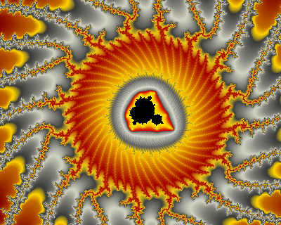](videos/Fractal-zoom-1-03-Mandelbrot_Buzzsaw.ogv)

[](videos/Mandelbrot_sequence_new.webm)

## Escape time algorithm

The simplest algorithm for generating a representation of the Mandelbrot set is known as the "escape time" algorithm. A repeating calculation is performed for each *x*, *y* point in the plot area and based on the behavior of that calculation, a color is chosen for that pixel.

### Unoptimized naïve escape time algorithm

In both the unoptimized and optimized escape time algorithms, the *x* and *y* locations of each point are used as starting values in a repeating, or iterating calculation (described in detail below). The result of each iteration is used as the starting values for the next. The values are checked during each iteration to see whether they have reached a critical "escape" condition, or "bailout". If that condition is reached, the calculation is stopped, the pixel is drawn, and the next *x*, *y* point is examined. For some starting values, escape occurs quickly, after only a small number of iterations. For starting values very close to but not in the set, it may take hundreds or thousands of iterations to escape. For values within the Mandelbrot set, escape will never occur. The programmer or user must choose how many iterations–or how much "depth"–they wish to examine. The higher the maximal number of iterations, the more detail and subtlety emerge in the final image, but the longer time it will take to calculate the fractal image.

Escape conditions can be simple or complex. Because no complex number with a real or imaginary part greater than 2 can be part of the set, a common bailout is to escape when either coefficient exceeds 2. A more computationally complex method that detects escapes sooner, is to compute distance from the origin using the Pythagorean theorem, i.e., to determine the absolute value, or *modulus*, of the complex number. If this value exceeds 2, or equivalently, when the sum of the squares of the real and imaginary parts exceed 4, the point has reached escape. More computationally intensive rendering variations include the Buddhabrot method, which finds escaping points and plots their iterated coordinates.

The color of each point represents how quickly the values reached the escape point. Often black is used to show values that fail to escape before the iteration limit, and gradually brighter colors are used for points that escape. This gives a visual representation of how many cycles were required before reaching the escape condition.

To render such an image, the region of the complex plane we are considering is subdivided into a certain number of pixels. To color any such pixel, let $c$ be the midpoint of that pixel. We now iterate the critical point 0 under $P_c$, checking at each step whether the orbit point has modulus larger than 2. When this is the case, we know that $c$ does not belong to the Mandelbrot set, and we color our pixel according to the number of iterations used to find out. Otherwise, we keep iterating up to a fixed number of steps, after which we decide that our parameter is "probably" in the Mandelbrot set, or at least very close to it, and color the pixel black.

In pseudocode, this algorithm would look as follows. The algorithm does not use complex numbers and manually simulates complex-number operations using two real numbers, for those who do not have a complex data type. The program may be simplified if the programming language includes complex-data-type operations.

```text
for each pixel (Px, Py) on the screen do
    x0 := scaled x coordinate of pixel (scaled to lie in the Mandelbrot X scale (-2.00, 0.47))
    y0 := scaled y coordinate of pixel (scaled to lie in the Mandelbrot Y scale (-1.12, 1.12))
    x := 0.0
    y := 0.0
    iteration := 0
    max_iteration := 1000
    while (x*x + y*y ≤ 2*2 AND iteration < max_iteration) do
        xtemp := x*x - y*y + x0
        y := 2*x*y + y0
        x := xtemp
        iteration := iteration + 1

    color := palette[iteration]
    plot(Px, Py, color)
```

Here, relating the pseudocode to $c$, $z$ and $P_c$:

- $z = x + iy$
- $z^2 = x^2 + 2ixy - y^2$
- $c = x_0 + iy_0$

and so, as can be seen in the pseudocode in the computation of *x* and *y*:

- $x = \operatorname{Re}(z^2+c) = x^2-y^2 + x_0$ and $y = \operatorname{Im}(z^2+c) = 2xy + y_0$.

To get colorful images of the set, the assignment of a color to each value of the number of executed iterations can be made using one of a variety of functions (linear, exponential, etc.). One practical way, without slowing down calculations, is to use the number of executed iterations as an entry to a palette initialized at startup. If the color table has, for instance, 500 entries, then the color selection is *n* mod 500, where *n* is the number of iterations.

### Optimized escape time algorithms

The code in the previous section uses an unoptimized inner while loop for clarity. In the unoptimized version, one must perform five multiplications per iteration. To reduce the number of multiplications the following code for the inner while loop may be used instead:

```text
x2:= 0
y2:= 0
w:= 0

while (x2 + y2 ≤ 4 and iteration < max_iteration) do
    x:= x2 - y2 + x0
    y:= w - x2 - y2 + y0
    x2:= x * x
    y2:= y * y
    w:= (x + y) * (x + y)
    iteration:= iteration + 1
```

The above code works via some algebraic simplification of the complex multiplication:

$$
\begin{aligned}
(iy + x)^2 &= -y^2 + 2iyx + x^2 \\
           &= x^2 - y^2 + 2iyx
\end{aligned}
$$

Using the above identity, the number of multiplications can be reduced to three instead of five.

The above inner while loop can be further optimized by expanding *w* to

$$w = x^{2} + 2xy + y^{2}$$

Substituting *w* into $y = w - x^{2} - y^{2} + y_0$ yields $y = 2xy + y_0$ and hence calculating *w* is no longer needed.

The further optimized pseudocode for the above is:

```text
x:= 0
y:= 0
x2:= 0
y2:= 0

while (x2 + y2 ≤ 4 and iteration < max_iteration) do
    x2:= x * x
    y2:= y * y
    y:= 2 * x * y + y0
    x:= x2 - y2 + x0
    iteration:= iteration + 1
```

Note that in the above pseudocode, $2xy$ seems to increase the number of multiplications by 1, but since 2 is the multiplier the code can be optimized via $(x + x)y$.

## Coloring algorithms

In addition to plotting the set, a variety of algorithms have been developed to

- efficiently color the set in an aesthetically pleasing way
- show structures of the data (scientific visualisation)

### Histogram coloring

A more complex coloring method involves using a histogram which pairs each pixel with said pixel's maximum iteration count before escape/bailout. This method will equally distribute colors to the same overall area, and, importantly, is independent of the maximum number of iterations chosen.<sup>[1]</sup>

This algorithm has four passes. The first pass involves calculating the iteration counts associated with each pixel (but without any pixels being plotted). These are stored in an array `IterationCounts[x][y]`, where `x` and `y` are the x and y coordinates of said pixel on the screen respectively.

| 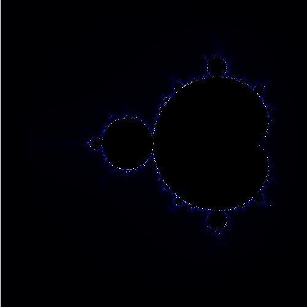 | 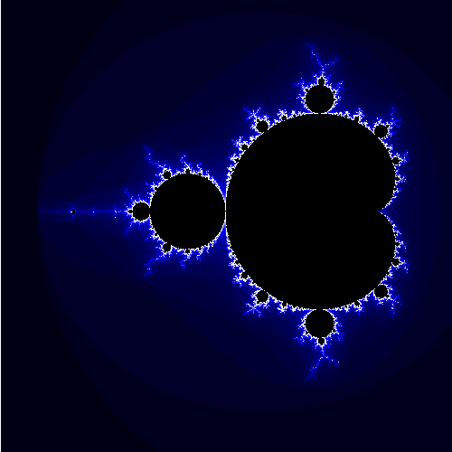 | 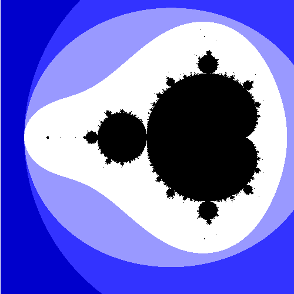 |
|:--:|:--:|:--:|
|  | 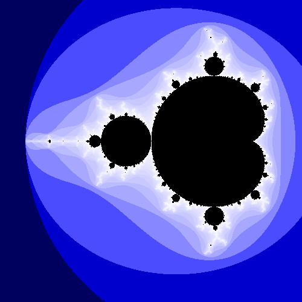 | 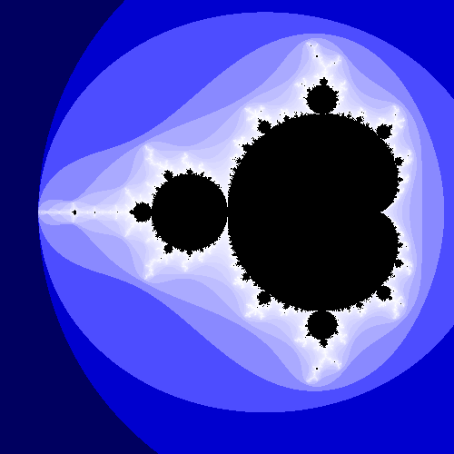 |

: The top row is a series of plots using the escape time algorithm for 10000, 1000 and 100 maximum iterations per pixel respectively. The bottom row uses the same maximum iteration values but utilizes the histogram coloring method. Notice how little the coloring changes per different maximum iteration counts for the histogram coloring method plots. (All six images: Jdbtwo, CC BY-SA 4.0)

The first step of the second pass is to create an array `NumIterationsPerPixel[n]`, where the array size `n` is the maximum iteration count. Next, one must iterate over the array of pixel-iteration count pairs `IterationCounts[x][y]`, and retrieve each pixel's saved iteration count, *i*, via e.g. `i = IterationCounts[x][y]`. After each pixel's iteration count *i* is retrieved, it is necessary to index the `NumIterationsPerPixel` array at *i* and increment the indexed value (which is initially zero) -- e.g. `NumIterationsPerPixel[i] = NumIterationsPerPixel[i] + 1`.

```text
for (x = 0; x < width; x++) do
    for (y = 0; y < height; y++) do
        i:= IterationCounts[x][y]
        NumIterationsPerPixel[i]++
```

The third pass iterates through the NumIterationsPerPixel array and adds up all the stored values, saving them in *total*. The array index represents the number of pixels that reached that iteration count before bailout.

```text
total: = 0
for (i = 0; i < max_iterations; i++) do
    total += NumIterationsPerPixel[i]
```

After this, the fourth pass begins and all the values in the IterationCounts array are indexed, and, for each iteration count *i*, associated with each pixel, the count is added to a global sum of all the iteration counts from 1 to *i* in the NumIterationsPerPixel array. This value is then normalized by dividing the sum by the *total* value computed earlier.

```text
hue[][]:= 0.0
for (x = 0; x < width; x++) do
    for (y = 0; y < height; y++) do
        iteration:= IterationCounts[x][y]
        for (i = 0; i <= iteration; i++) do
            hue[x][y] += NumIterationsPerPixel[i] / total /* Must be floating-point division. */

...

color = palette[hue[m, n]]

...
```

Finally, the computed value is used, e.g. as an index to a color palette.

This method may be combined with the smooth coloring method below for more aesthetically pleasing images.

### Continuous (smooth) coloring

The escape time algorithm is popular for its simplicity. However, it creates bands of color, which, as a type of aliasing, can detract from an image's aesthetic value. This can be improved using an algorithm known as "normalized iteration count",<sup>[2][3]</sup> which provides a smooth transition of colors between iterations. The algorithm associates a real number $\nu$ with each value of *z* by using the connection of the iteration number with the potential function. This function is given by

$$\phi(z) = \lim_{n \to \infty} (\log|z_n|/P^{n}),$$

where *z*<sub>*n*</sub> is the value after *n* iterations and *P* is the power for which *z* is raised to in the Mandelbrot set equation (*z*<sub>*n*+1</sub> = *z*<sub>*n*</sub><sup>*P*</sup> + *c*, *P* is generally 2).

If we choose a large bailout radius *N* (e.g., 10<sup>100</sup>), we have that

$$\log|z_n|/P^{n} = \log(N)/P^{\nu(z)}$$

for some real number $\nu(z)$, and this is

$$\nu(z) = n - \log_P (\log|z_n|/\log(N)),$$

and as *n* is the first iteration number such that |*z*<sub>*n*</sub>| > *N*, the number we subtract from *n* is in the interval [0, 1).

For the coloring we must have a cyclic scale of colors (constructed mathematically, for instance) and containing *H* colors numbered from 0 to *H* − 1 (*H* = 500, for instance). We multiply the real number $\nu(z)$ by a fixed real number determining the density of the colors in the picture, take the integral part of this number modulo *H*, and use it to look up the corresponding color in the color table.

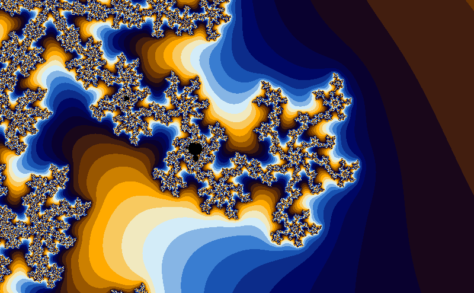


For example, modifying the above pseudocode and also using the concept of linear interpolation would yield

```text
for each pixel (Px, Py) on the screen do
    x0:= scaled x coordinate of pixel (scaled to lie in the Mandelbrot X scale (-2.5, 1))
    y0:= scaled y coordinate of pixel (scaled to lie in the Mandelbrot Y scale (-1, 1))
    x:= 0.0
    y:= 0.0
    iteration:= 0
    max_iteration:= 1000
    // Here N = 2^8 is chosen as a reasonable bailout radius.

    while x*x + y*y ≤ (1 << 16) and iteration < max_iteration do
        xtemp:= x*x - y*y + x0
        y:= 2*x*y + y0
        x:= xtemp
        iteration:= iteration + 1

    // Used to avoid floating point issues with points inside the set.
    if iteration < max_iteration then
        // sqrt of inner term removed using log simplification rules.
        log_zn:= log(x*x + y*y) / 2
        nu:= log(log_zn / log(2)) / log(2)
        // Rearranging the potential function.
        // Dividing log_zn by log(2) instead of log(N = 1<<8)
        // because we want the entire palette to range from the
        // center to radius 2, NOT our bailout radius.
        iteration:= iteration + 1 - nu

    color1:= palette[floor(iteration)]
    color2:= palette[floor(iteration) + 1]
    // iteration % 1 = fractional part of iteration.
    color:= linear_interpolate(color1, color2, iteration % 1)
    plot(Px, Py, color)
```

### Exponentially mapped and cyclic iterations

Typically when we render a fractal, the range of where colors from a given palette appear along the fractal is static. If we desire to offset the location from the border of the fractal, or adjust their palette to cycle in a specific way, there are a few simple changes we can make when taking the final iteration count before passing it along to choose an item from our palette.

When we have obtained the iteration count, we can make the range of colors non-linear. Raising a value normalized to the range [0,1] to a power *n*, maps a linear range to an exponential range, which in our case can nudge the appearance of colors along the outside of the fractal, and allow us to bring out other colors, or push in the entire palette closer to the border.

$$v = ((\mathbf{i} / max_i)^\mathbf{S}\mathbf{N})^{1.5} \bmod \mathbf{N}$$

where **i** is our iteration count after bailout, **max_i** is our iteration limit, **S** is the exponent we are raising iters to, and **N** is the number of items in our palette. This scales the iter count non-linearly and scales the palette to cycle approximately proportionally to the zoom.

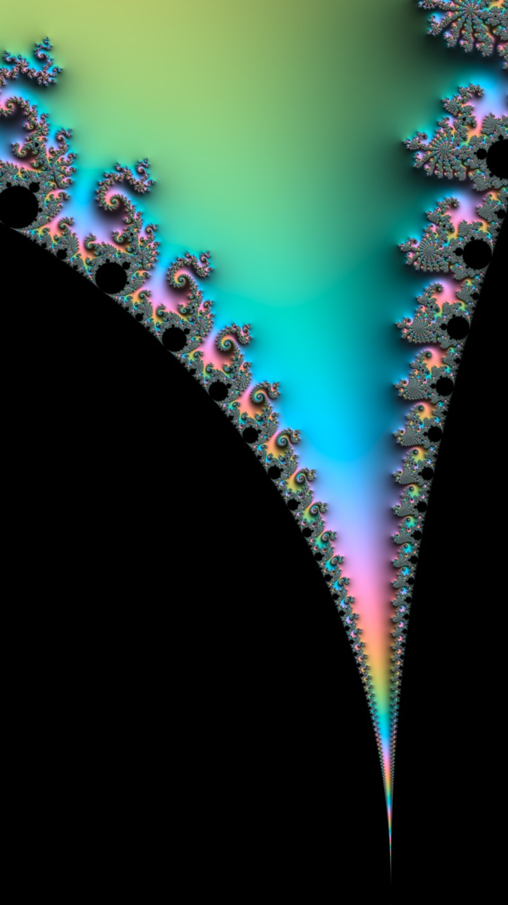

We can then plug v into whatever algorithm we desire for generating a color.

### Passing iterations into a color directly

One thing we may want to consider is avoiding having to deal with a palette or color blending at all. There are actually a handful of methods we can leverage to generate smooth, consistent coloring by constructing the color on the spot.

#### v refers to a normalized exponentially mapped cyclic iter count

#### f(v) refers to the sRGB transfer function

A naive method for generating a color in this way is by directly scaling **v** to 255 and passing it into RGB as such

```text
rgb = [v * 255, v * 255, v * 255]
```

One flaw with this is that RGB is non-linear due to gamma; consider linear sRGB instead. Going from RGB to sRGB uses an inverse companding function on the channels. This makes the gamma linear, and allows us to properly sum the colors for sampling.

```text
srgb = [v * 255, v * 255, v * 255]
```

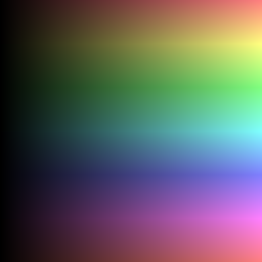

#### HSV coloring

HSV Coloring can be accomplished by mapping iter count from [0,max_iter) to [0,360), taking it to the power of 1.5, and then modulo 360.

$$h = ((i/max_i)360)^{1.5} \bmod 360$$

We can then simply take the exponentially mapped iter count into the value and return

```text
hsv = [powf((i / max) * 360, 1.5) % 360, 100, (i / max) * 100]
```

This method applies to HSL as well, except we pass a saturation of 50% instead.

```text
hsl = [powf((i / max) * 360, 1.5) % 360, 50, (i / max) * 100]
```

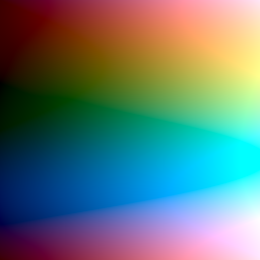

#### LCH coloring

One of the most perceptually uniform coloring methods involves passing in the processed iter count into LCH. If we utilize the exponentially mapped and cyclic method above, we can take the result of that into the Luma and Chroma channels. We can also exponentially map the iter count and scale it to 360, and pass this modulo 360 into the hue.

$$
\begin{array}{lcl}
x   & \in & \mathbb{Q}^+ \\
s_i & =   & (i/max_i)^\mathbf{x} \\
v   & =   & 1.0 - \cos^2(\pi s_i) \\
L   & =   & 75 - (75v) \\
C   & =   & 28 + (75 - 75v) \\
H   & =   & (360s_i)^{1.5} \bmod 360
\end{array}
$$

One issue we wish to avoid here is out-of-gamut colors. This can be achieved with a little trick based on the change in-gamut colors relative to luma and chroma. As we increase luma, we need to decrease chroma to stay within gamut.

```text
s = iters/max_i;
v = 1.0 - powf(cos(pi * s), 2.0);
LCH = [75 - (75 * v), 28 + (75 - (75 * v)), powf(360 * s, 1.5) % 360];
```

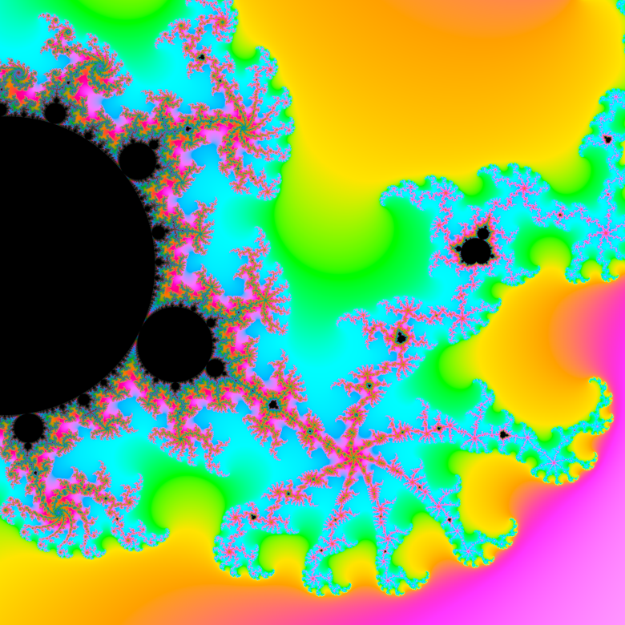

## Advanced plotting algorithms

In addition to the simple and slow escape time algorithms already discussed, there are many other more advanced algorithms that can be used to speed up the plotting process.

### Distance estimates

One can compute the distance from point *c* (in exterior or interior) to nearest point on the boundary of the Mandelbrot set.<sup>[4][5]</sup>

#### Exterior distance estimation

The proof of the connectedness of the Mandelbrot set in fact gives a formula for the uniformizing map of the complement of $M$ (and the derivative of this map). By the Koebe quarter theorem, one can then estimate the distance between the midpoint of our pixel and the Mandelbrot set up to a factor of 4.

In other words, provided that the maximal number of iterations is sufficiently high, one obtains a picture of the Mandelbrot set with the following properties:

1. Every pixel that contains a point of the Mandelbrot set is colored black.
2. Every pixel that is colored black is close to the Mandelbrot set.

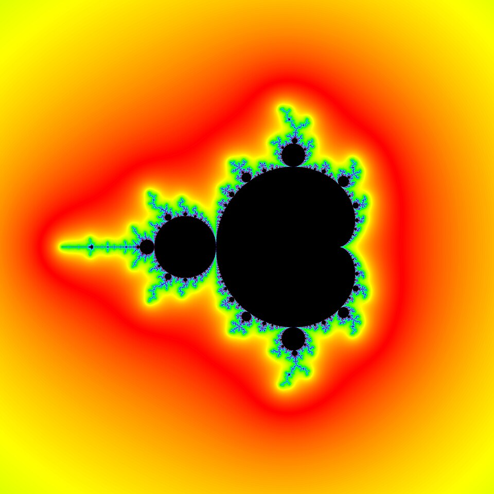

The upper bound *b* for the distance estimate of a pixel *c* (a complex number) from the Mandelbrot set is given by<sup>[6][7][8]</sup>

$$b=\lim_{n \to \infty} \frac{2 \cdot |{P_c^n(c)| \cdot \ln|{P_c^n(c)}}|}{|\frac{\partial}{\partial{c}} P_c^n(c)|},$$

where

- $P_c(z)$ stands for complex quadratic polynomial
- $P_c^n(c)$ stands for *n* iterations of $P_c(z) \to z$ or $z^2 + c \to z$, starting with $z=c$: $P_c^{0}(c) = c$, $P_c^{n+1}(c) = P_c^n(c)^2 + c$;
- $\frac{\partial}{\partial{c}} P_c^n(c)$ is the derivative of $P_c^n(c)$ with respect to c. This derivative can be found by starting with $\frac{\partial}{\partial{c}} P_c^{0}(c) = 1$ and then $\frac{\partial}{\partial{c}} P_c^{n+1}(c) = 2\cdot{}P_c^n(c)\cdot\frac{\partial}{\partial{c}} P_c^n(c) + 1$. This can easily be verified by using the chain rule for the derivative.

The idea behind this formula is simple: When the equipotential lines for the potential function $\phi(z)$ lie close, the number $|\phi'(z)|$ is large, and conversely, therefore the equipotential lines for the function $\phi(z)/|\phi'(z)|$ should lie approximately regularly.

From a mathematician's point of view, this formula only works in limit where *n* goes to infinity, but very reasonable estimates can be found with just a few additional iterations after the main loop exits.

Once *b* is found, by the Koebe 1/4-theorem, we know that there is no point of the Mandelbrot set with distance from *c* smaller than *b/4*.

The distance estimation can be used for drawing of the boundary of the Mandelbrot set, see the article Julia set. In this approach, pixels that are sufficiently close to M are drawn using a different color. This creates drawings where the thin "filaments" of the Mandelbrot set can be easily seen. This technique is used to good effect in the B&W images of Mandelbrot sets in the books "The Beauty of Fractals<sup>[9]</sup>" and "The Science of Fractal Images".<sup>[10]</sup>

Here is a sample B&W image rendered using Distance Estimates:

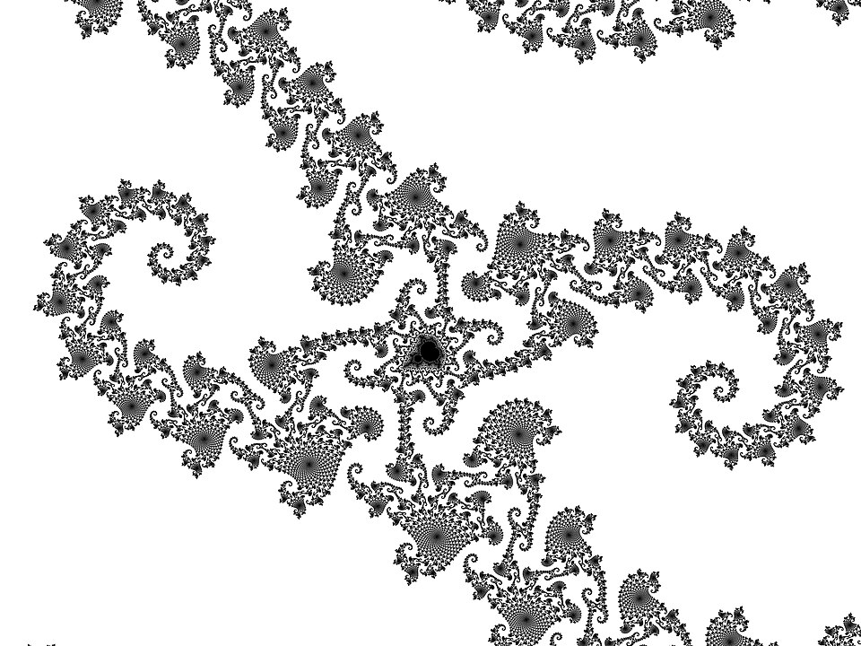

Distance Estimation can also be used to render 3D images of Mandelbrot and Julia sets

#### Interior distance estimation

It is also possible to estimate the distance of a limitly periodic (i.e., hyperbolic) point to the boundary of the Mandelbrot set. The upper bound *b* for the distance estimate is given by<sup>[4]</sup>

$$
b=\frac{1-\left|{\frac{\partial}{\partial{z}}P_c^p(z_0)}\right|^2}
  {\left|{\frac{\partial}{\partial{c}}\frac{\partial}{\partial{z}}P_c^p(z_0) +
        \frac{\partial}{\partial{z}}\frac{\partial}{\partial{z}}P_c^p(z_0)
        \frac{\frac{\partial}{\partial{c}}P_c^p(z_0)}
             {1-\frac{\partial}{\partial{z}}P_c^p(z_0)}} \right|},
$$

where

- $p$ is the period,
- $c$ is the point to be estimated,
- $P_c(z)$ is the complex quadratic polynomial $P_c(z)=z^2 + c$
- $P_c^p(z_0)$ is the $p$-fold iteration of $P_c(z) \to z$, starting with $P_c^{0}(z) = z_0$
- $z_0$ is any of the $p$ points that make the attractor of the iterations of $P_c(z) \to z$ starting with $P_c^{0}(z) = c$; $z_0$ satisfies $z_0 = P_c^p(z_0)$,
- $\frac{\partial}{\partial{c}}\frac{\partial}{\partial{z}}P_c^p(z_0)$, $\frac{\partial}{\partial{z}}\frac{\partial}{\partial{z}}P_c^p(z_0)$, $\frac{\partial}{\partial{c}}P_c^p(z_0)$ and $\frac{\partial}{\partial{z}}P_c^p(z_0)$ are various derivatives of $P_c^p(z)$, evaluated at $z_0$.

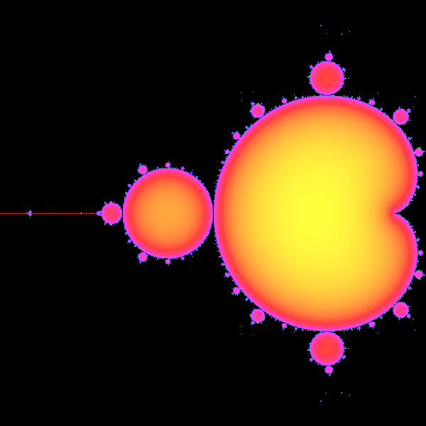

Analogous to the exterior case, once *b* is found, we know that all points within the distance of *b*/4 from *c* are inside the Mandelbrot set.

There are two practical problems with the interior distance estimate: first, we need to find $z_0$ precisely, and second, we need to find $p$ precisely. The problem with $z_0$ is that the convergence to $z_0$ by iterating $P_c(z)$ requires, theoretically, an infinite number of operations. The problem with any given $p$ is that, sometimes, due to rounding errors, a period is falsely identified to be an integer multiple of the real period (e.g., a period of 86 is detected, while the real period is only 43=86/2). In such case, the distance is overestimated, i.e., the reported radius could contain points outside the Mandelbrot set.

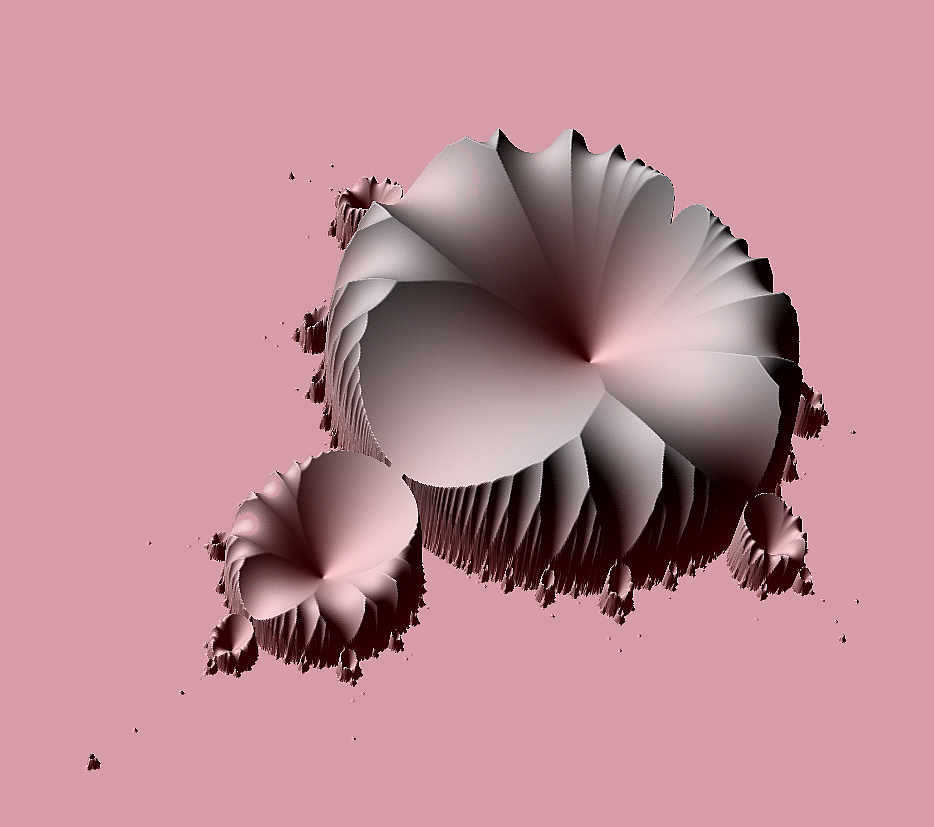

### Cardioid / bulb checking

One way to improve calculations is to find out beforehand whether the given point lies within the cardioid or in the period-2 bulb. Before passing the complex value through the escape time algorithm, first check that:

$$p = \sqrt{ \left(x - \frac{1}{4}\right)^2 + y^2 },$$

$$x \leq p - 2p^2 + \frac{1}{4},$$

$$(x+1)^2 + y^2 \leq \frac{1}{16},$$

where *x* represents the real value of the point and *y* the imaginary value. The first two equations determine that the point is within the cardioid, the last the period-2 bulb.

The cardioid test can equivalently be performed without the square root:

$$q = \left(x - \frac{1}{4}\right)^2 + y^2,$$

$$q \left(q + \left(x - \frac{1}{4}\right)\right) \leq \frac{1}{4}y^2.$$

3rd- and higher-order buds do not have equivalent tests, because they are not perfectly circular.<sup>[11]</sup> However, it is possible to find whether the points are within circles inscribed within these higher-order bulbs, preventing many, though not all, of the points in the bulb from being iterated.

### Periodicity checking

To prevent having to do huge numbers of iterations for points inside the set, one can perform periodicity checking, which checks whether a point reached in iterating a pixel has been reached before. If so, the pixel cannot diverge and must be in the set. Periodicity checking is a trade-off, as the need to remember points costs data management instructions and memory, but saves computational instructions. However, checking against only one previous iteration can detect many periods with little performance overhead. For example, within the while loop of the pseudocode above, make the following modifications:

```text
xold := 0
yold := 0
period := 0
while (x*x + y*y ≤ 2*2 and iteration < max_iteration) do
    xtemp := x*x - y*y + x0
    y := 2*x*y + y0
    x := xtemp
    iteration := iteration + 1

    if x ≈ xold and y ≈ yold then
        iteration := max_iteration  /* Set to max for the color plotting */
        break        /* We are inside the Mandelbrot set, leave the while loop */

    period:= period + 1
    if period > 20 then
        period := 0
        xold := x
        yold := y
```

The above code stores away a new x and y value on every 20th iteration, thus it can detect periods that are up to 20 points long.

### Border tracing / edge checking

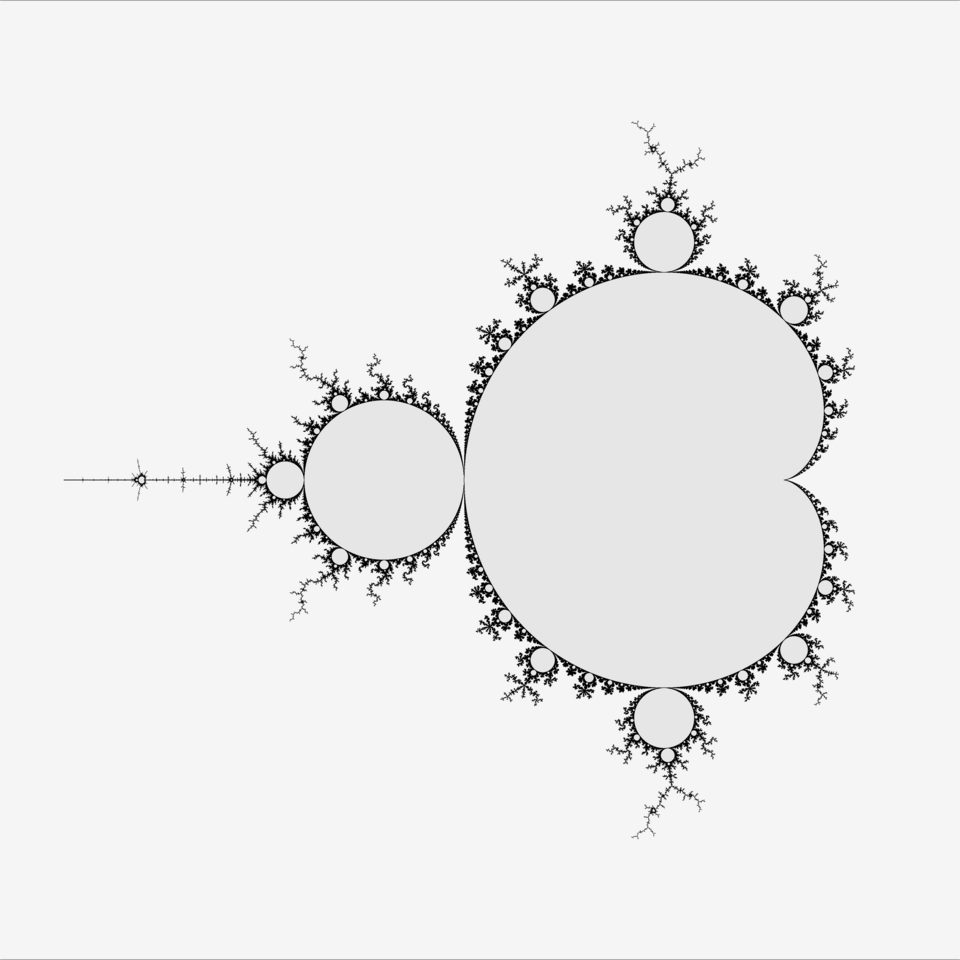

Because the Mandelbrot set is full,<sup>[12]</sup> any point enclosed by a closed shape whose borders lie entirely within the Mandelbrot set must itself be in the Mandelbrot set. Border tracing works by following the lemniscates of the various iteration levels (colored bands) all around the set, and then filling the entire band at once. This also provides a speed increase because large numbers of points can be now skipped.<sup>[13]</sup>

[](videos/Boundary_following_movie.webm)

In the animation shown, points outside the set are colored with a 1000-iteration escape time algorithm. Tracing the set border and filling it, rather than iterating the interior points, reduces the total number of iterations by 93.16%. With a higher iteration limit the benefit would be even greater.

### Rectangle checking

Rectangle checking is an older and simpler method for plotting the Mandelbrot set. The basic idea of rectangle checking is that if every pixel in a rectangle's border shares the same amount of iterations, then the rectangle can be safely filled using that number of iterations. There are several variations of the rectangle checking method, however, all of them are slower than the border tracing method because they end up calculating more pixels. One variant just calculates the corner pixels of each rectangle, however, this causes damaged pictures more often than calculating the entire border, thus it only works reasonably well if only small boxes of around 6x6 pixels are used, and no recursing in from bigger boxes. (Fractint method.)

The most simple rectangle checking method lies in checking the borders of equally sized rectangles, resembling a grid pattern. (Mariani's algorithm.)<sup>[14]</sup>

A faster and slightly more advanced variant is to first calculate a bigger box, say 25x25 pixels. If the entire box border has the same color, then just fill the box with the same color. If not, then split the box into four boxes of 13x13 pixels, reusing the already calculated pixels as outer border, and sharing the inner "cross" pixels between the inner boxes. Again, fill in those boxes that has only one border color. And split those boxes that don't, now into four 7x7 pixel boxes. And then those that "fail" into 4x4 boxes. (Mariani-Silver algorithm.)

Even faster is to split the boxes in half instead of into four boxes. Then it might be optimal to use boxes with a 1.4:1 aspect ratio, so they can be split like how A3 papers are folded into A4 and A5 papers. (The DIN approach.)

As with border tracing, rectangle checking only works on areas with one discrete color. But even if the outer area uses smooth/continuous coloring then rectangle checking will still speed up the costly inner area of the Mandelbrot set. Unless the inner area also uses some smooth coloring method, for instance interior distance estimation.

### Symmetry utilization

The horizontal symmetry of the Mandelbrot set allows for portions of the rendering process to be skipped upon the presence of the real axis in the final image. However, regardless of the portion that gets mirrored, the same number of points will be rendered.

Julia sets have symmetry around the origin. This means that quadrant 1 and quadrant 3 are symmetric, and quadrants 2 and quadrant 4 are symmetric. Supporting symmetry for both Mandelbrot and Julia sets requires handling symmetry differently for the two different types of graphs.

### Multithreading

Escape-time rendering of Mandelbrot and Julia sets lends itself extremely well to parallel processing. On multi-core machines the area to be plotted can be divided into a series of rectangular areas which can then be provided as a set of tasks to be rendered by a pool of rendering threads. This is an embarrassingly parallel<sup>[15]</sup> computing problem. (Note that one gets the best speed-up by first excluding symmetric areas of the plot, and then dividing the remaining unique regions into rectangular areas.)<sup>[16]</sup>

Here is a short video showing the Mandelbrot set being rendered using multithreading and symmetry, but without boundary following:

[](videos/Multi-threaded_mandelbrot_render_w_symmetry.webm)

Finally, here is a video showing the same Mandelbrot set image being rendered using multithreading, symmetry, **and** boundary following:

[](videos/Multi-threaded_mandelbrot_render_w_boundary_following_and_symmetry.webm)

### Perturbation theory and series approximation

Very highly magnified images require more than the standard 64–128 or so bits of precision that most hardware floating-point units provide, requiring renderers to use slow "BigNum" or "arbitrary-precision" math libraries to calculate. However, this can be sped up by the exploitation of perturbation theory. Given

$$z_{n+1} = z_n^2 + c$$

as the iteration, and a small epsilon and delta, it is the case that

$$(z_n + \epsilon)^2 + (c + \delta) = z_n^2 + 2z_n\epsilon + \epsilon^2 + c + \delta,$$

or

$$= z_{n+1} + 2z_n\epsilon + \epsilon^2 + \delta,$$

so if one defines

$$\epsilon_{n+1} = 2z_n\epsilon_n + \epsilon_n^2 + \delta,$$

one can calculate a single point (e.g. the center of an image) using high-precision arithmetic (*z*), giving a *reference orbit*, and then compute many points around it in terms of various initial offsets delta plus the above iteration for epsilon, where epsilon-zero is set to 0. For most iterations, epsilon does not need more than 16 significant figures, and consequently hardware floating-point may be used to get a mostly accurate image.<sup>[17]</sup> There will often be some areas where the orbits of points diverge enough from the reference orbit that extra precision is needed on those points, or else additional local high-precision-calculated reference orbits are needed. By measuring the orbit distance between the reference point and the point calculated with low precision, it can be detected that it is not possible to calculate the point correctly, and the calculation can be stopped. These incorrect points can later be re-calculated e.g. from another closer reference point.

Further, it is possible to approximate the starting values for the low-precision points with a truncated Taylor series, which often enables a significant amount of iterations to be skipped.<sup>[18]</sup> Renderers implementing these techniques are publicly available and offer speedups for highly magnified images by around two orders of magnitude.<sup>[19][20]</sup>

An alternate explanation of the above:

For the central point in the disc $c$ and its iterations $z_n$, and an arbitrary point in the disc $c + \delta$ and its iterations $z'_n$, it is possible to define the following iterative relationship:

$$z'_{n} = z_{n} + \epsilon_{n}$$

With $\epsilon_{1} = \delta$. Successive iterations of $\epsilon_n$ can be found using the following:

$$z'_{n+1} = {z'_n}^2 + (c + \delta)$$

$$z'_{n+1} = (z_n + \epsilon_n)^2 + c + \delta$$

$$z'_{n+1} = {z_n}^2 + c + 2z_n\epsilon_n + {\epsilon_n}^2 + \delta$$

$$z'_{n+1} = z_{n+1} + 2z_n\epsilon_n + {\epsilon_n}^2 + \delta$$

Now from the original definition:

$$z'_{n+1} = z_{n+1} + \epsilon_{n+1},$$

It follows that:

$$\epsilon_{n+1} = 2z_n\epsilon_n + {\epsilon_n}^2 + \delta$$

As the iterative relationship relates an arbitrary point to the central point by a very small change $\delta$, then most of the iterations of $\epsilon_n$ are also small and can be calculated using floating point hardware.

However, for every arbitrary point in the disc it is possible to calculate a value for a given $\epsilon_{n}$ without having to iterate through the sequence from $\epsilon_0$, by expressing $\epsilon_n$ as a power series of $\delta$.

$$\epsilon_n = A_{n}\delta + B_{n}\delta^2 + C_{n}\delta^3 + \dotsc$$

With $A_{1} = 1, B_{1} = 0, C_{1} = 0, \dotsc$.

Now given the iteration equation of $\epsilon$, it is possible to calculate the coefficients of the power series for each $\epsilon_n$:

$$\epsilon_{n+1} = 2z_n\epsilon_n + {\epsilon_n}^2 + \delta$$

$$\epsilon_{n+1} = 2z_n(A_n\delta + B_n\delta^2 + C_n\delta^3 + \dotsc) + (A_n\delta + B_n\delta^2 + C_n\delta^3 + \dotsc)^2 + \delta$$

$$\epsilon_{n+1} = (2z_nA_n+1)\delta + (2z_nB_n + {A_n}^2)\delta^2 + (2z_nC_n + 2A_nB_n)\delta^3 + \dotsc$$

Therefore, it follows that:

$$A_{n+1} = 2z_nA_n + 1$$

$$B_{n+1} = 2z_nB_n + {A_n}^2$$

$$C_{n+1} = 2z_nC_n + 2A_nB_n$$

$$\vdots$$

The coefficients in the power series can be calculated as iterative series using only values from the central point's iterations $z$, and do not change for any arbitrary point in the disc. If $\delta$ is very small, $\epsilon_n$ should be calculable to sufficient accuracy using only a few terms of the power series. As the Mandelbrot Escape Contours are 'continuous' over the complex plane, if a point's escape time has been calculated, then the escape time of that point's neighbours should be similar. Interpolation of the neighbouring points should provide a good estimation of where to start in the $\epsilon_n$ series.

Further, separate interpolation of both real axis points and imaginary axis points should provide both an upper and lower bound for the point being calculated. If both results are the same (i.e. both escape or do not escape) then the difference $\Delta n$ can be used to recuse until both an upper and lower bound can be established. If floating point hardware can be used to iterate the $\epsilon$ series, then there exists a relation between how many iterations can be achieved in the time it takes to use BigNum software to compute a given $\epsilon_n$. If the difference between the bounds is greater than the number of iterations, it is possible to perform binary search using BigNum software, successively halving the gap until it becomes more time efficient to find the escape value using floating point hardware.

| 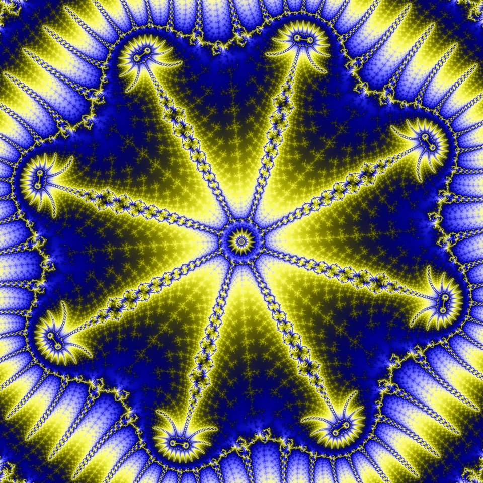 | 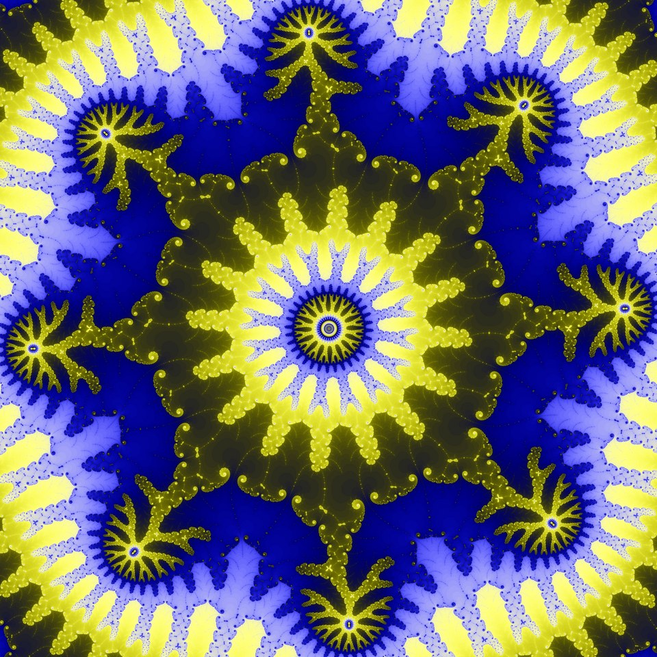 | 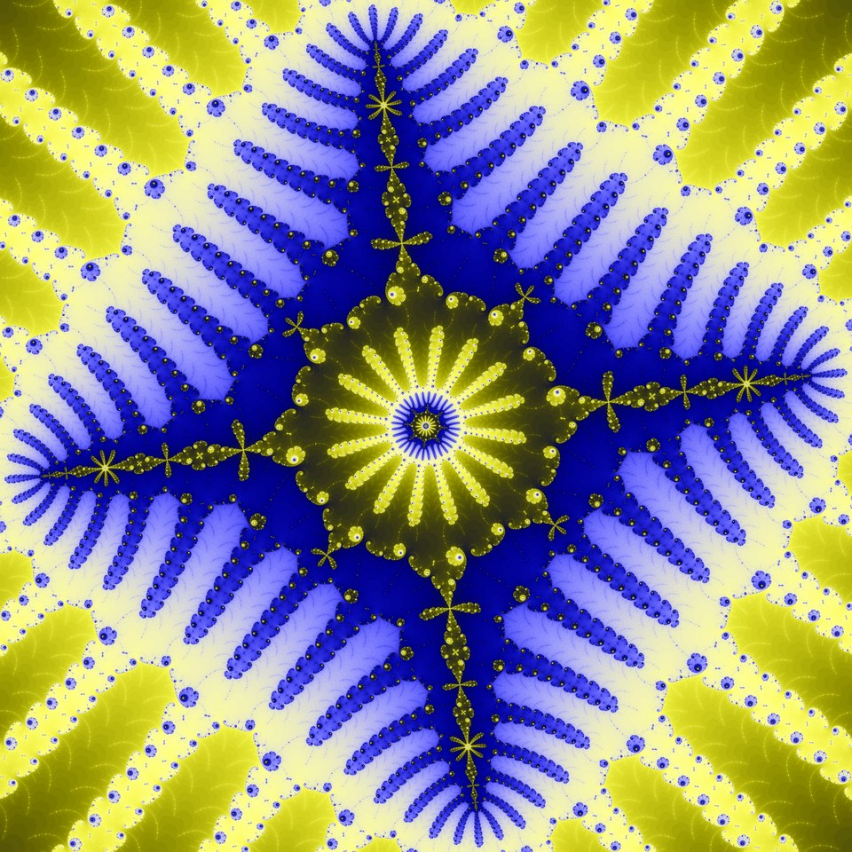 |
|:--:|:--:|:--:|
| 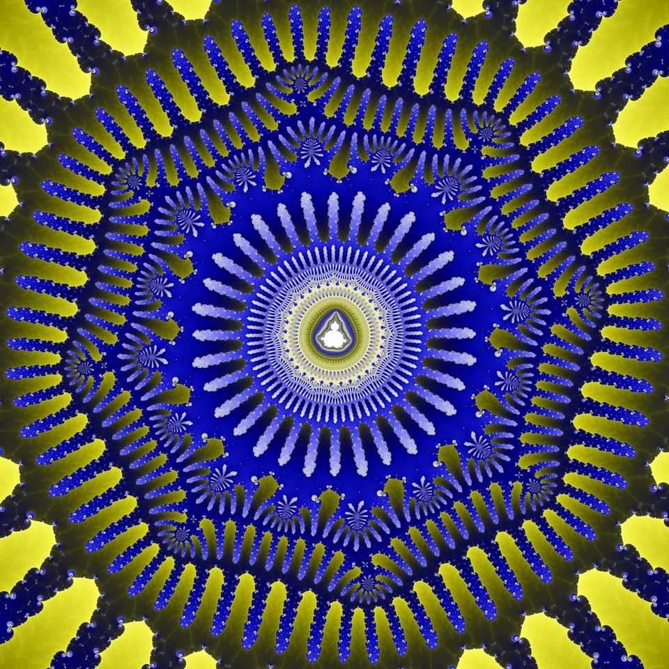 | 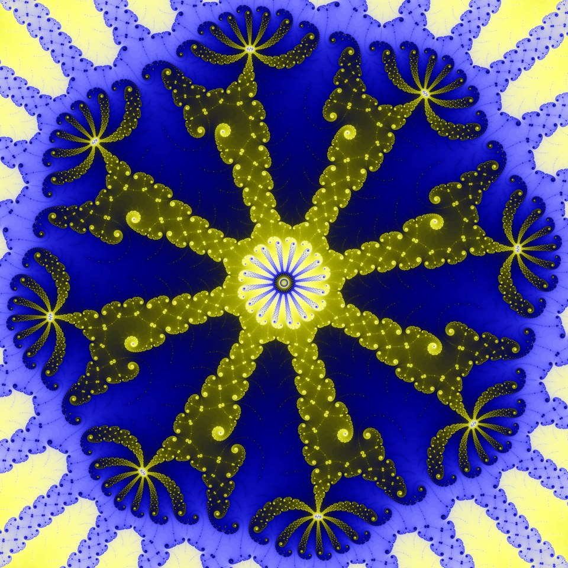 | 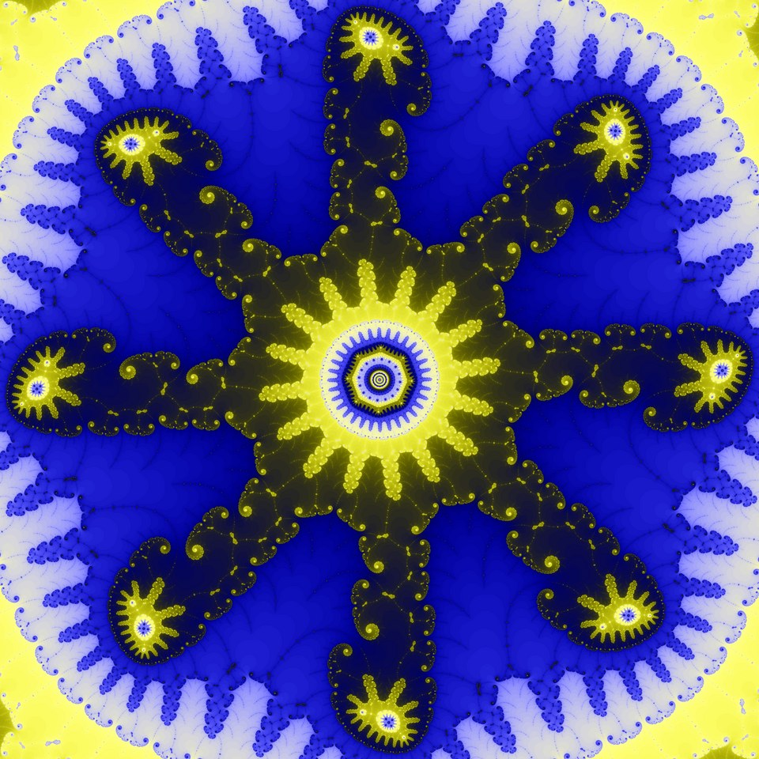 |

: Zoom levels obtained with perturbation theory. (All six images: Aokoroko, CC0)

## References

1. "Newbie: How to map colors in the Mandelbrot set?" (http://www.fractalforums.com/programming/newbie-how-to-map-colors-in-the-mandelbrot-set/msg3465/#msg3465). www.fractalforums.com. May 2007. Archived (https://web.archive.org/web/20220909215450/http://www.fractalforums.com/programming/newbie-how-to-map-colors-in-the-mandelbrot-set/msg3465/#msg3465) from the original on 9 September 2022. Retrieved 11 February 2020.
2. García, Francisco; Ángel Fernández; Javier Barrallo; Luis Martín. "Coloring Dynamical Systems in the Complex Plane" (http://math.unipa.it/~grim/Jbarrallo.PDF) (PDF). Archived (https://web.archive.org/web/20191130214645/http://math.unipa.it/%7Egrim/Jbarrallo.PDF) (PDF) from the original on 30 November 2019. Retrieved 21 January 2008.
3. Linas Vepstas. "Renormalizing the Mandelbrot Escape" (http://linas.org/art-gallery/escape/escape.html). Archived (https://web.archive.org/web/20200214073730/http://linas.org/art-gallery/escape/escape.html) from the original on 14 February 2020. Retrieved 11 February 2020.
4. Albert Lobo. "Interior and exterior distance bounds for the Mandelbrot set" (http://www.albertlobo.com/fractals/interior-exterior-distance-bounds-mandelbrot-set). Archived (https://web.archive.org/web/20220909215805/http://www.albertlobo.com/fractals/interior-exterior-distance-bounds-mandelbrot-set) from the original on 9 September 2022. Retrieved 29 April 2021.
5. Wilson, Dr. Lindsay Robert (2012). "Distance estimation method for drawing Mandelbrot and Julia sets" (http://www.imajeenyus.com/mathematics/20121112_distance_estimates/distance_estimation_method_for_fractals.pdf) (PDF). Archived (https://web.archive.org/web/20210503103652/http://www.imajeenyus.com/mathematics/20121112_distance_estimates/distance_estimation_method_for_fractals.pdf) (PDF) from the original on 3 May 2021. Retrieved 3 May 2021.
6. Chéritat, Arnaud (2016). "Boundary detection methods via distance estimators" (https://www.math.univ-toulouse.fr/~cheritat/wiki-draw/index.php/Mandelbrot_set#Boundary_detection_methods_via_distance_estimators). Archived (https://web.archive.org/web/20221218100822/https://www.math.univ-toulouse.fr/~cheritat/wiki-draw/index.php/Mandelbrot_set) from the original on 18 December 2022. Retrieved 2 January 2023.
7. Christensen, Mikael Hvidtfeldt (2011). "Distance Estimated 3D Fractals (V): The Mandelbulb & Different DE Approximations" (http://blog.hvidtfeldts.net/index.php/2011/09/distance-estimated-3d-fractals-v-the-mandelbulb-different-de-approximations). Archived (https://web.archive.org/web/20210513033347/http://blog.hvidtfeldts.net/index.php/2011/09/distance-estimated-3d-fractals-v-the-mandelbulb-different-de-approximations/) from the original on 13 May 2021. Retrieved 10 May 2021.
8. Dang, Yumei; Louis Kauffman; Daniel Sandin (2002). "Chapter 3.3: The Distance Estimation Formula". Hypercomplex Iterations: Distance Estimation and Higher Dimensional Fractals (https://www.evl.uic.edu/hypercomplex/html/book/book.pdf) (PDF). World Scientific. pp. 17–18. Archived (https://web.archive.org/web/20210323153331/https://www.evl.uic.edu/hypercomplex/html/book/book.pdf) (PDF) from the original on 23 March 2021. Retrieved 29 April 2021.
9. Peitgen, Heinz-Otto; Richter Peter (1986). The Beauty of Fractals. Heidelberg: Springer-Verlag. ISBN 0-387-15851-0.
10. Peitgen, Heinz-Otto; Saupe Dietmar (1988). The Science of Fractal Images. New York: Springer-Verlag. p. 202. ISBN 0-387-96608-0.
11. "Mandelbrot Bud Maths" (http://linas.org/art-gallery/bud/bud.html). Archived (https://web.archive.org/web/20200214073800/http://linas.org/art-gallery/bud/bud.html) from the original on 14 February 2020. Retrieved 11 February 2020.
12. Douady, Adrien; Hubbard, John (2009). "Exploring the Mandelbrot set. Exploring the Mandelbrot set. The Orsay Notes" (https://www.researchgate.net/publication/228540477). Retrieved 9 April 2023.
13. "Boundary Tracing Method" (https://web.archive.org/web/20150220012221/http://www.reocities.com/CapeCanaveral/5003/mandel.htm). Archived from the original (http://www.reocities.com/CapeCanaveral/5003/mandel.htm) on 20 February 2015.
14. Dewdney, A. K. (1989). "Computer Recreations, February 1989; A tour of the Mandelbrot set aboard the Mandelbus". Scientific American. p. 111. JSTOR 24987149 (https://www.jstor.org/stable/24987149). (subscription required)
15. "Embarrassingly Parallel Problems" (https://web.archive.org/web/20200127230256/http://courses.cecs.anu.edu.au/courses/COMP4300/lectures/embParallel.4u.pdf) (PDF). Archived from the original (http://courses.cecs.anu.edu.au/courses/COMP4300/lectures/embParallel.4u.pdf) (PDF) on 27 January 2020.
16. "Parallel Program Models" (https://web.archive.org/web/20200126040920/http://cseweb.ucsd.edu/groups/csag/html/teaching/cse160s05/lectures/Lecture14.pdf) (PDF). Archived from the original (http://cseweb.ucsd.edu/groups/csag/html/teaching/cse160s05/lectures/Lecture14.pdf) (PDF) on 26 January 2020.
17. "Superfractalthing - Arbitrary Precision Mandelbrot Set Rendering in Java" (http://www.fractalforums.com/announcements-and-news/superfractalthing-arbitrary-precision-mandelbrot-set-rendering-in-java/). Archived (https://web.archive.org/web/20200630043303/http://www.fractalforums.com/announcements-and-news/superfractalthing-arbitrary-precision-mandelbrot-set-rendering-in-java/) from the original on 30 June 2020. Retrieved 11 February 2020.
18. K. I. Martin. "Superfractalthing Maths" (https://web.archive.org/web/20140628114658/http://www.superfractalthing.co.nf/sft_maths.pdf) (PDF). Archived from the original (http://www.superfractalthing.co.nf/sft_maths.pdf) (PDF) on 28 June 2014. Retrieved 11 February 2020.
19. "Mandelbrot set implementation with Perturbation Theory" (https://rosettacode.org/wiki/Mandelbrot_set#Perturbation_Theory). Rosetta Code. Retrieved 6 July 2026.
20. "Kalles Fraktaler 2" (http://www.chillheimer.de/kallesfraktaler/). Archived (https://web.archive.org/web/20200224054206/http://www.chillheimer.de/kallesfraktaler/) from the original on 24 February 2020. Retrieved 11 February 2020.

Retrieved from "https://en.wikipedia.org/w/index.php?title=Plotting_algorithms_for_the_Mandelbrot_set&oldid=1380046103"

Text is available under the Creative Commons Attribution-ShareAlike License 4.0; additional terms may apply. Media files are licensed as stated in [LICENSES.md](LICENSES.md).
