# Mandelbrot 集的绘制算法

绘制 Mandelbrot 集以及其他分形有许多程序和算法，其中一些已在分形生成软件中有所描述。这些程序使用各种算法来高效地确定各个像素的颜色。

[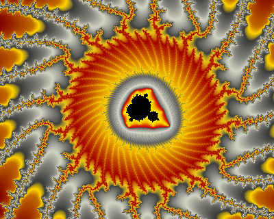](videos/Fractal-zoom-1-03-Mandelbrot_Buzzsaw.ogv)

[](videos/Mandelbrot_sequence_new.webm)

## 逃逸时间算法

生成 Mandelbrot 集图像的最简单算法被称为“逃逸时间”（escape time）算法。对绘图区域中的每个 *x*、*y* 点执行一次重复计算，并根据该计算的行为为该像素选定一种颜色。

### 未优化的朴素逃逸时间算法

在未优化和已优化的逃逸时间算法中，每个点的 *x* 与 *y* 位置都被用作重复（迭代）计算的起始值（下文将详细说明）。每次迭代的结果都作为下一次迭代的起始值。每次迭代时都会检查这些值是否已满足临界的“逃逸”（escape）条件，即“逃逸判据”（bailout）。一旦满足该条件，计算便停止，绘制该像素，然后检查下一个 *x*、*y* 点。对某些起始值而言，逃逸发生得很快，只需很少几次迭代；对于非常接近集合内部但不在集合内的起始值，可能需要数百甚至数千次迭代才会逃逸；而对于集合内部的值，则永远不会逃逸。程序员或用户必须选择他们希望考察的迭代次数——或者说“深度”。最大迭代次数越高，最终图像中呈现的细节与微妙之处就越多，但计算该分形图像所需的时间也越长。

逃逸条件可以是简单的，也可以是复杂的。由于实部或虚部大于 2 的复数不可能属于该集合，一种常见的逃逸判据是任一系数超过 2 即判定为逃逸。另一种计算上更复杂、但能更早检测到逃逸的方法是：用勾股定理计算到原点的距离，即求出该复数的绝对值（模）。若该值超过 2，等价地说，若实部与虚部的平方和超过 4，则该点已经逃逸。计算量更大的渲染变体还包括 Buddhabrot 方法，它找出逃逸点并绘制其迭代坐标。

每个点的颜色表示其数值达到逃逸点的快慢。通常用黑色表示在迭代上限之前未能逃逸的值，而逃逸的点则使用逐渐明亮的颜色。这样就以可视化的方式呈现了在达到逃逸条件之前所需经历的循环次数。

要渲染这样一幅图像，我们把所考察的复平面区域细分为一定数量的像素。要为其中任一像素着色，令 $c$ 为该像素的中点。现在我们在 $P_c$ 下迭代临界点 0，并在每一步检查轨道点的模是否大于 2。若是，则知 $c$ 不属于 Mandelbrot 集，我们根据查明这一点所用的迭代次数为该像素着色。否则，我们继续迭代直到一个固定的步数上限；此后我们判定该参数“很可能”属于 Mandelbrot 集，或至少非常接近它，并把该像素涂成黑色。

用伪代码表示，该算法如下所示。该算法不使用复数，而是用两个实数手工模拟复数运算，以照顾没有复数数据类型的读者。若所用编程语言支持复数类型运算，程序可以进一步简化。

```text
for each pixel (Px, Py) on the screen do
    x0 := scaled x coordinate of pixel (scaled to lie in the Mandelbrot X scale (-2.00, 0.47))
    y0 := scaled y coordinate of pixel (scaled to lie in the Mandelbrot Y scale (-1.12, 1.12))
    x := 0.0
    y := 0.0
    iteration := 0
    max_iteration := 1000
    while (x*x + y*y ≤ 2*2 AND iteration < max_iteration) do
        xtemp := x*x - y*y + x0
        y := 2*x*y + y0
        x := xtemp
        iteration := iteration + 1

    color := palette[iteration]
    plot(Px, Py, color)
```

这里，伪代码与 $c$、$z$、$P_c$ 的对应关系为：

- $z = x + iy$
- $z^2 = x^2 + 2ixy - y^2$
- $c = x_0 + iy_0$

因此，正如在伪代码中对 *x* 和 *y* 的计算所体现的那样：

- $x = \operatorname{Re}(z^2+c) = x^2-y^2 + x_0$，且 $y = \operatorname{Im}(z^2+c) = 2xy + y_0$。

要得到色彩丰富的集合图像，可以用各种函数（线性、指数等）之一把迭代次数的每个取值映射为一种颜色。一种不拖慢计算速度的实用做法是：以执行的迭代次数作为启动时初始化好的调色板的下标。例如，若颜色表有 500 个表项，则颜色选择为 *n* mod 500，其中 *n* 为迭代次数。

### 优化的逃逸时间算法

上一节的代码为了清晰起见使用了未优化的内层 while 循环。在未优化版本中，每次迭代必须执行五次乘法。为减少乘法次数，可以改用下面这段内层 while 循环代码：

```text
x2:= 0
y2:= 0
w:= 0

while (x2 + y2 ≤ 4 and iteration < max_iteration) do
    x:= x2 - y2 + x0
    y:= w - x2 - y2 + y0
    x2:= x * x
    y2:= y * y
    w:= (x + y) * (x + y)
    iteration:= iteration + 1
```

上述代码通过对复数乘法做一些代数化简来工作：

$$
\begin{aligned}
(iy + x)^2 &= -y^2 + 2iyx + x^2 \\
           &= x^2 - y^2 + 2iyx
\end{aligned}
$$

利用上述恒等式，乘法次数可以从五次减少到三次。

把 *w* 展开，还可以进一步优化上述内层 while 循环：

$$w = x^{2} + 2xy + y^{2}$$

把 *w* 代入 $y = w - x^{2} - y^{2} + y_0$ 得到 $y = 2xy + y_0$，因此不再需要计算 *w*。

进一步优化后的伪代码如下：

```text
x:= 0
y:= 0
x2:= 0
y2:= 0

while (x2 + y2 ≤ 4 and iteration < max_iteration) do
    x2:= x * x
    y2:= y * y
    y:= 2 * x * y + y0
    x:= x2 - y2 + x0
    iteration:= iteration + 1
```

注意，在上述伪代码中 $2xy$ 看似使乘法次数增加 1，但由于乘数是 2，代码可以通过 $(x + x)y$ 来优化。

## 着色算法

除了绘制集合本身，人们还发展出了多种算法，用来

- 以美观的方式高效地为集合着色
- 展示数据的结构（科学可视化）

### 直方图着色

一种更复杂的着色方法使用直方图，把每个像素与该像素在逃逸/跳出之前的最大迭代次数对应起来。这种方法会把颜色均匀地分配到相同的整体面积上，而且重要的是，它与所选择的最大迭代次数无关。<sup>[1]</sup>

该算法分为四遍。第一遍计算与每个像素相关联的迭代次数（但不绘制任何像素），把它们存入数组 `IterationCounts[x][y]`，其中 `x`、`y` 分别是该像素在屏幕上的 x、y 坐标。

| 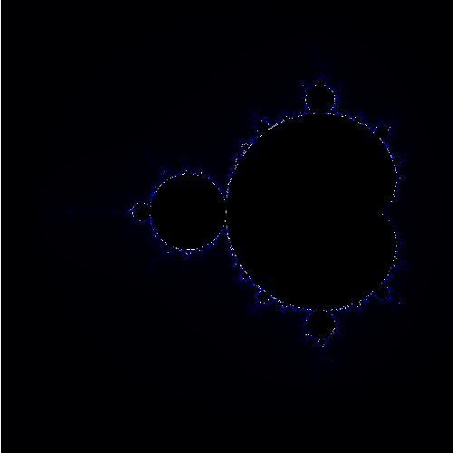 | 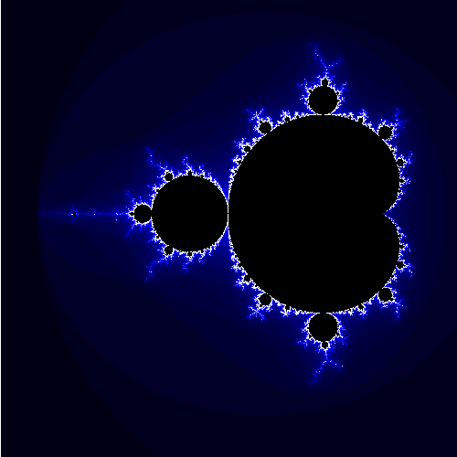 | 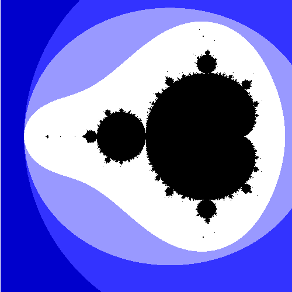 |
|:--:|:--:|:--:|
|  | 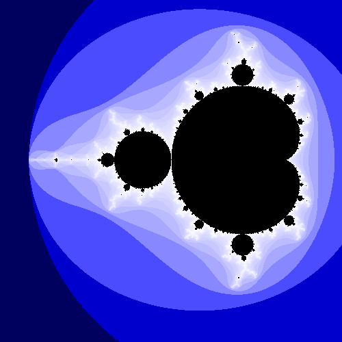 | 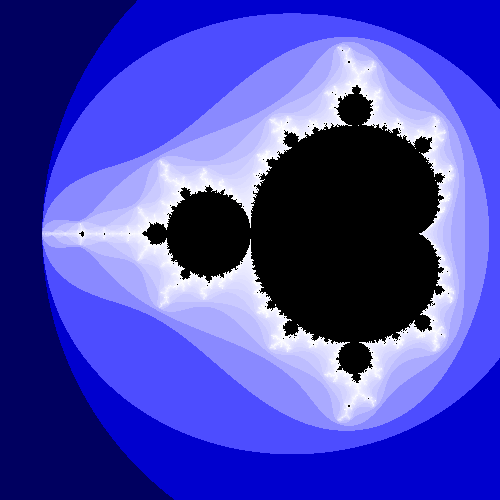 |

: 上排是分别使用逃逸时间算法、每像素最大迭代次数为 10000、1000 和 100 的一组图像。下排使用相同的最大迭代次数，但采用直方图着色方法。请注意直方图着色图像的颜色随最大迭代次数变化的程度有多小。（六幅图像均为 Jdbtwo 所作，CC BY-SA 4.0）

第二遍的第一步是创建数组 `NumIterationsPerPixel[n]`，其中数组大小 `n` 为最大迭代次数。接着遍历像素—迭代次数对数组 `IterationCounts[x][y]`，取出每个像素保存的迭代次数 *i*，例如 `i = IterationCounts[x][y]`。取出每个像素的迭代次数 *i* 后，需要以 *i* 为下标索引 `NumIterationsPerPixel` 数组，并把该下标处的值（初值为零）加一——例如 `NumIterationsPerPixel[i] = NumIterationsPerPixel[i] + 1`。

```text
for (x = 0; x < width; x++) do
    for (y = 0; y < height; y++) do
        i:= IterationCounts[x][y]
        NumIterationsPerPixel[i]++
```

第三遍遍历 NumIterationsPerPixel 数组，把所有存储的值相加，保存在 *total* 中。数组下标表示在跳出之前达到该迭代次数的像素个数。

```text
total: = 0
for (i = 0; i < max_iterations; i++) do
    total += NumIterationsPerPixel[i]
```

此后开始第四遍：对 IterationCounts 数组中的所有值建立索引，对于每个像素所关联的每个迭代次数 *i*，把 NumIterationsPerPixel 数组中从 1 到 *i* 的所有迭代次数之和累加到全局和中。随后用该和除以前面算出的 *total* 值进行归一化。

```text
hue[][]:= 0.0
for (x = 0; x < width; x++) do
    for (y = 0; y < height; y++) do
        iteration:= IterationCounts[x][y]
        for (i = 0; i <= iteration; i++) do
            hue[x][y] += NumIterationsPerPixel[i] / total /* Must be floating-point division. */

...

color = palette[hue[m, n]]

...
```

最后，把算出的值用作调色板的下标等。

该方法可以与下文的平滑着色方法结合使用，以获得更美观的图像。

### 连续（平滑）着色

逃逸时间算法因其简单而广受欢迎。然而它会产生色彩条带，作为一种混叠现象，这会损害图像的美学价值。使用一种被称为“归一化迭代次数”（normalized iteration count）的算法可以改善这一点，<sup>[2][3]</sup> 它在迭代之间提供平滑的颜色过渡。该算法利用迭代次数与势函数之间的联系，为每个 *z* 值关联一个实数 $\nu$。该函数由下式给出：

$$\phi(z) = \lim_{n \to \infty} (\log|z_n|/P^{n}),$$

其中 *z*<sub>*n*</sub> 是经过 *n* 次迭代后的值，*P* 是在 Mandelbrot 集方程（*z*<sub>*n*+1</sub> = *z*<sub>*n*</sub><sup>*P*</sup> + *c*）中 *z* 的幂次，*P* 一般为 2。

若选取一个较大的逃逸半径 *N*（例如 10<sup>100</sup>），则有

$$\log|z_n|/P^{n} = \log(N)/P^{\nu(z)}$$

其中 $\nu(z)$ 为某个实数，于是

$$\nu(z) = n - \log_P (\log|z_n|/\log(N)),$$

又因为 *n* 是使 |*z*<sub>*n*</sub>| > *N* 的第一个迭代次数，所以从 *n* 中减去的那个数位于区间 [0, 1) 内。

为了着色，我们必须有一个循环的颜色标度（例如用数学方式构造的），其中包含从 0 到 *H* − 1 编号的 *H* 种颜色（例如 *H* = 500）。我们把实数 $\nu(z)$ 乘以一个决定图像中颜色密度的固定实数，取该数的整数部分对 *H* 取模，再用它在颜色表中查找相应的颜色。

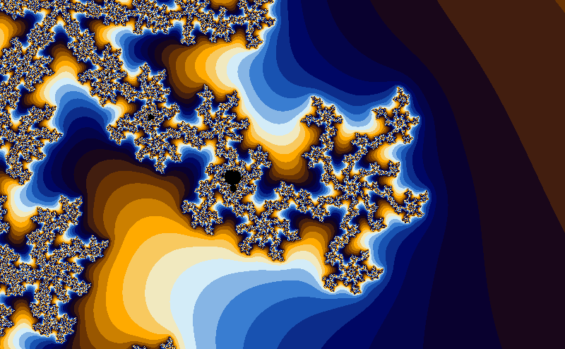

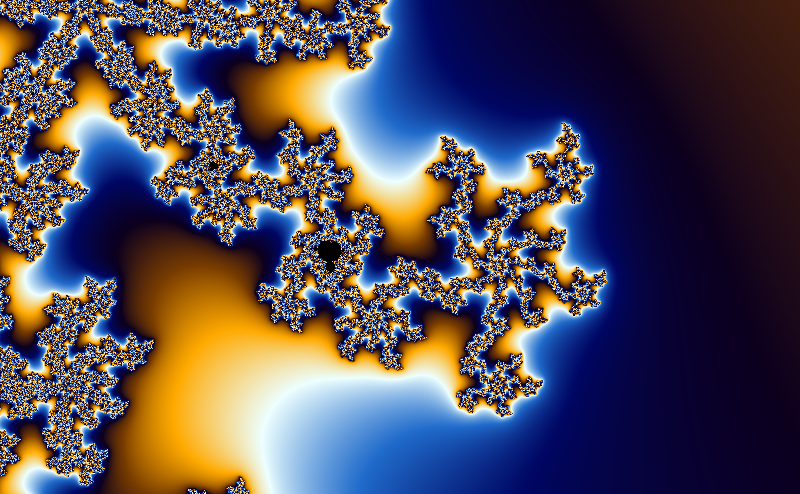

例如，修改上面的伪代码并使用线性插值的思想，会得到

```text
for each pixel (Px, Py) on the screen do
    x0:= scaled x coordinate of pixel (scaled to lie in the Mandelbrot X scale (-2.5, 1))
    y0:= scaled y coordinate of pixel (scaled to lie in the Mandelbrot Y scale (-1, 1))
    x:= 0.0
    y:= 0.0
    iteration:= 0
    max_iteration:= 1000
    // Here N = 2^8 is chosen as a reasonable bailout radius.

    while x*x + y*y ≤ (1 << 16) and iteration < max_iteration do
        xtemp:= x*x - y*y + x0
        y:= 2*x*y + y0
        x:= xtemp
        iteration:= iteration + 1

    // Used to avoid floating point issues with points inside the set.
    if iteration < max_iteration then
        // sqrt of inner term removed using log simplification rules.
        log_zn:= log(x*x + y*y) / 2
        nu:= log(log_zn / log(2)) / log(2)
        // Rearranging the potential function.
        // Dividing log_zn by log(2) instead of log(N = 1<<8)
        // because we want the entire palette to range from the
        // center to radius 2, NOT our bailout radius.
        iteration:= iteration + 1 - nu

    color1:= palette[floor(iteration)]
    color2:= palette[floor(iteration) + 1]
    // iteration % 1 = fractional part of iteration.
    color:= linear_interpolate(color1, color2, iteration % 1)
    plot(Px, Py, color)
```

### 指数映射与循环迭代

通常，我们渲染分形时，某一调色板的颜色沿分形出现的位置范围是固定的。如果我们希望把它们相对分形边界的位置加以偏移，或调整调色板以特定方式循环，那么在取得最终迭代次数、并将其传递给调色板以选取颜色之前，可以做几处简单的改动。

在得到迭代次数之后，我们可以让颜色的取值范围变为非线性的。把一个归一化到 [0,1] 区间的值取 *n* 次幂，就把线性范围映射为指数范围；在我们的情形下，这可以推动分形外部颜色的呈现，让我们显出其他颜色，或把整个调色板推向更靠近边界的位置。

$$v = ((\mathbf{i} / max_i)^\mathbf{S}\mathbf{N})^{1.5} \bmod \mathbf{N}$$

其中 **i** 是跳出后的迭代次数，**max_i** 是迭代上限，**S** 是我们对迭代次数所取的指数，**N** 是调色板中的条目数。这样迭代次数被非线性地缩放，调色板循环的尺度也近似与缩放比例成正比。

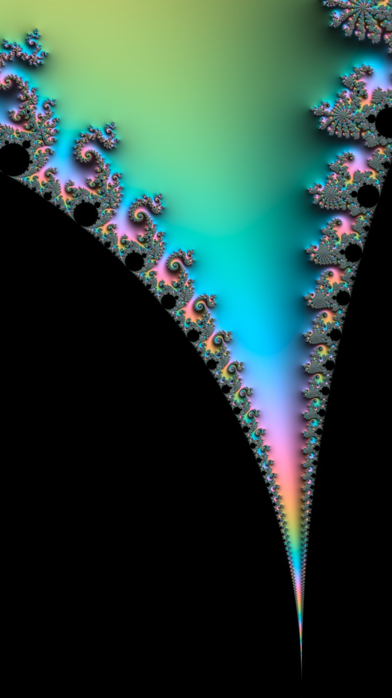

然后我们就可以把 v 代入任何我们想要的生成颜色的算法中。

### 直接把迭代次数映射为颜色

有一点我们或许值得考虑：完全避免处理调色板或颜色混合。实际上有若干方法可以利用，通过就地构造颜色来生成平滑、一致的着色。

#### v 指归一化的、经指数映射的循环迭代次数

#### f(v) 指 sRGB 传递函数

一种朴素的颜色生成方法，是把 **v** 直接缩放到 255 并这样传入 RGB：

```text
rgb = [v * 255, v * 255, v * 255]
```

这样做的一个缺陷是：由于 gamma 的存在，RGB 是非线性的；应当考虑改用线性 sRGB。从 RGB 转到 sRGB 会对各通道施加一个反压扩（inverse companding）函数。这使 gamma 变为线性，从而让我们能正确地为采样而合成颜色。

```text
srgb = [v * 255, v * 255, v * 255]
```

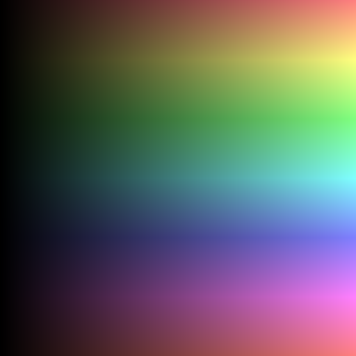

#### HSV 着色

HSV 着色可以通过把迭代次数从 [0,max_iter) 映射到 [0,360)，再取 1.5 次幂，然后对 360 取模来实现。

$$h = ((i/max_i)360)^{1.5} \bmod 360$$

然后我们只需把经指数映射的迭代次数当作取值返回：

```text
hsv = [powf((i / max) * 360, 1.5) % 360, 100, (i / max) * 100]
```

该方法同样适用于 HSL，只是饱和度改为 50%。

```text
hsl = [powf((i / max) * 360, 1.5) % 360, 50, (i / max) * 100]
```

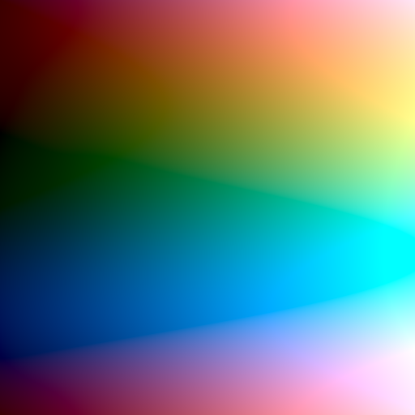

#### LCH 着色

感知上最均匀的着色方法之一，是把处理后的迭代次数传入 LCH。如果利用上面所述的指数映射与循环方法，我们可以把其结果用于明度（Luma）和色度（Chroma）通道；也可以对迭代次数做指数映射并缩放到 360，再对 360 取模后作为色相。

$$
\begin{array}{lcl}
x   & \in & \mathbb{Q}^+ \\
s_i & =   & (i/max_i)^\mathbf{x} \\
v   & =   & 1.0 - \cos^2(\pi s_i) \\
L   & =   & 75 - (75v) \\
C   & =   & 28 + (75 - 75v) \\
H   & =   & (360s_i)^{1.5} \bmod 360
\end{array}
$$

这里我们希望避免的一个问题是超出色域（out-of-gamut）的颜色。这可以借助一个小技巧来实现：依据色域内颜色相对于明度与色度的变化关系。当明度增大时，我们需要减小色度以保持在色域之内。

```text
s = iters/max_i;
v = 1.0 - powf(cos(pi * s), 2.0);
LCH = [75 - (75 * v), 28 + (75 - (75 * v)), powf(360 * s, 1.5) % 360];
```

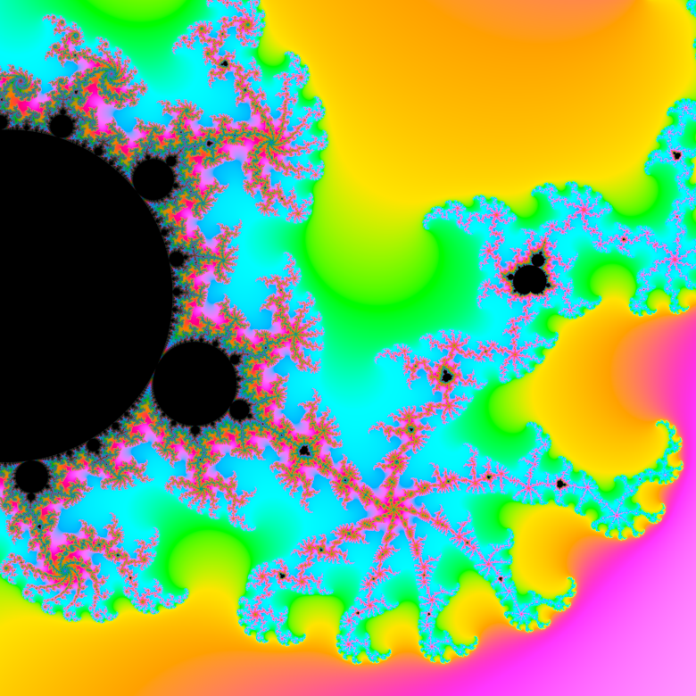

## 高级绘制算法

除了前面已经讨论过的简单而缓慢的逃逸时间算法之外，还有许多更高级的算法可用于加速绘制过程。

### 距离估计

可以计算点 *c*（位于外部或内部）到 Mandelbrot 集边界上最近点的距离。<sup>[4][5]</sup>

#### 外部距离估计

Mandelbrot 集连通性的证明，实际上给出了 $M$ 的补集的单值化映射（及其导数）的公式。于是，由 Koebe 四分之一定理，可以把像素中点与 Mandelbrot 集之间的距离估计到一个不超过 4 倍的因子之内。

换句话说，只要最大迭代次数足够高，就能得到具有以下性质的 Mandelbrot 集图像：

1. 每个包含 Mandelbrot 集内某点的像素都被着成黑色。
2. 每个被着成黑色的像素都靠近 Mandelbrot 集。

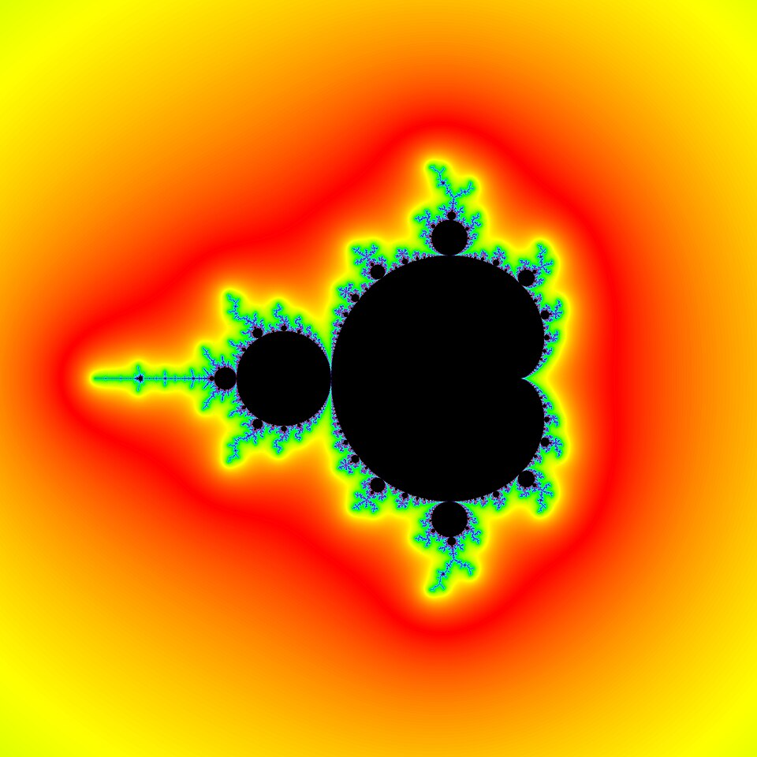

像素 *c*（一个复数）到 Mandelbrot 集的距离估计的上界 *b* 由下式给出<sup>[6][7][8]</sup>

$$b=\lim_{n \to \infty} \frac{2 \cdot |{P_c^n(c)| \cdot \ln|{P_c^n(c)}}|}{|\frac{\partial}{\partial{c}} P_c^n(c)|},$$

其中

- $P_c(z)$ 表示复二次多项式；
- $P_c^n(c)$ 表示 $P_c(z) \to z$ 或 $z^2 + c \to z$ 的 *n* 次迭代，从 $z=c$ 开始：$P_c^{0}(c) = c$，$P_c^{n+1}(c) = P_c^n(c)^2 + c$；
- $\frac{\partial}{\partial{c}} P_c^n(c)$ 是 $P_c^n(c)$ 对 c 的导数。该导数可以从 $\frac{\partial}{\partial{c}} P_c^{0}(c) = 1$ 出发，按下式 $\frac{\partial}{\partial{c}} P_c^{n+1}(c) = 2\cdot{}P_c^n(c)\cdot\frac{\partial}{\partial{c}} P_c^n(c) + 1$ 求出。用导数的链式法则很容易验证这一点。

该公式背后的想法很简单：当势函数 $\phi(z)$ 的等势线彼此靠得很近时，$|\phi'(z)|$ 的数值就很大；反过来，函数 $\phi(z)/|\phi'(z)|$ 的等势线应当近似地均匀分布。

从数学家的角度看，该公式只在 *n* 趋于无穷的极限下成立，但在主循环退出后只需再多迭代几次，就能得到相当合理的估计。

一旦求出 *b*，由 Koebe 1/4 定理可知，Mandelbrot 集中不存在与 *c* 的距离小于 *b/4* 的点。

距离估计可用于绘制 Mandelbrot 集的边界，参见 Julia 集条目。在这种做法中，与 M 足够接近的像素用另一种颜色绘制。这样绘制出的图像中，Mandelbrot 集那些纤细的“丝状”结构很容易看清。该技术在《The Beauty of Fractals<sup>[9]</sup>》和《The Science of Fractal Images》<sup>[10]</sup> 两本书中 Mandelbrot 集的黑白插图里取得了很好的效果。

下面是用距离估计渲染出的一幅黑白示例图像：

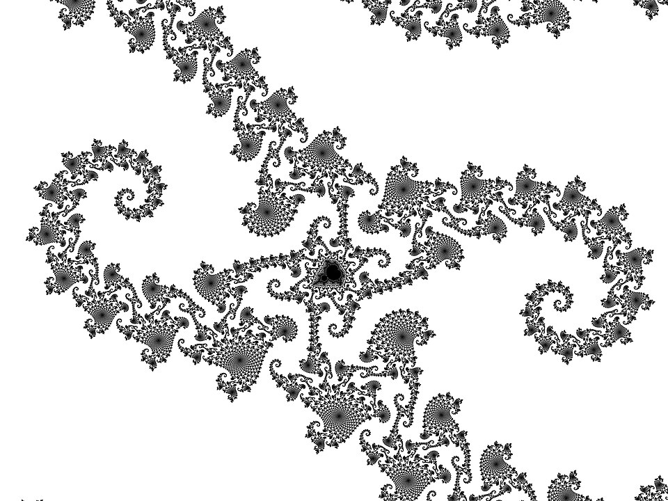

距离估计也可以用来渲染 Mandelbrot 集与 Julia 集的三维图像。

#### 内部距离估计

同样可以估计极限周期点（即双曲点）到 Mandelbrot 集边界的距离。距离估计的上界 *b* 由下式给出<sup>[4]</sup>

$$
b=\frac{1-\left|{\frac{\partial}{\partial{z}}P_c^p(z_0)}\right|^2}
  {\left|{\frac{\partial}{\partial{c}}\frac{\partial}{\partial{z}}P_c^p(z_0) +
        \frac{\partial}{\partial{z}}\frac{\partial}{\partial{z}}P_c^p(z_0)
        \frac{\frac{\partial}{\partial{c}}P_c^p(z_0)}
             {1-\frac{\partial}{\partial{z}}P_c^p(z_0)}} \right|},
$$

其中

- $p$ 是周期，
- $c$ 是待估计的点，
- $P_c(z)$ 是复二次多项式 $P_c(z)=z^2 + c$，
- $P_c^p(z_0)$ 是 $P_c(z) \to z$ 的 $p$ 次迭代，从 $P_c^{0}(z) = z_0$ 开始，
- $z_0$ 是从 $P_c^{0}(z) = c$ 开始迭代 $P_c(z) \to z$ 所得吸引子的 $p$ 个点中的任意一个；$z_0$ 满足 $z_0 = P_c^p(z_0)$，
- $\frac{\partial}{\partial{c}}\frac{\partial}{\partial{z}}P_c^p(z_0)$、$\frac{\partial}{\partial{z}}\frac{\partial}{\partial{z}}P_c^p(z_0)$、$\frac{\partial}{\partial{c}}P_c^p(z_0)$ 与 $\frac{\partial}{\partial{z}}P_c^p(z_0)$ 是 $P_c^p(z)$ 在 $z_0$ 处求值的各种导数。

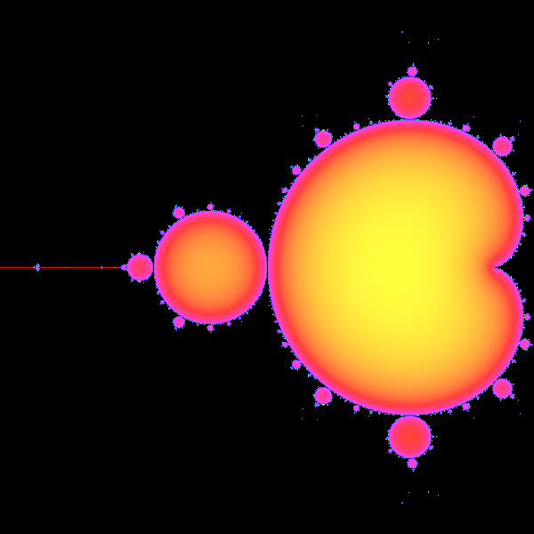

与外部情形类似，一旦求出 *b*，我们就知道与 *c* 距离在 *b*/4 以内的所有点都在 Mandelbrot 集内部。

内部距离估计有两个实际问题：第一，需要精确求出 $z_0$；第二，需要精确求出 $p$。$z_0$ 的问题在于，通过迭代 $P_c(z)$ 收敛到 $z_0$ 理论上需要无穷多次运算。而给定 $p$ 的问题在于，有时由于舍入误差，会把周期错误地识别为真实周期的整数倍（例如检测到周期为 86，而真实周期只有 43=86/2）。这种情况下距离会被高估，即所报告的半径可能包含 Mandelbrot 集之外的点。

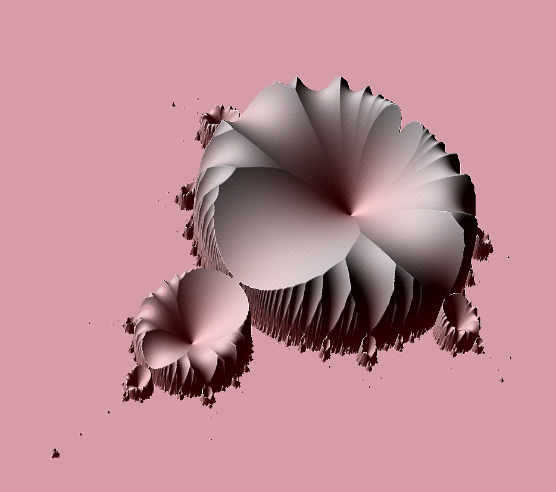

### 心形线与球检查

改进计算的一种方法是事先判断给定点是否落在心形线（cardioid）内或二阶周期球（period-2 bulb）内。在把该复数值送入逃逸时间算法之前，先检查：

$$p = \sqrt{ \left(x - \frac{1}{4}\right)^2 + y^2 },$$

$$x \leq p - 2p^2 + \frac{1}{4},$$

$$(x+1)^2 + y^2 \leq \frac{1}{16},$$

其中 *x* 表示该点的实部，*y* 表示其虚部。前两个方程判定该点位于心形线内，最后一个判定其位于二阶周期球内。

心形线判断也可以等价地不使用平方根：

$$q = \left(x - \frac{1}{4}\right)^2 + y^2,$$

$$q \left(q + \left(x - \frac{1}{4}\right)\right) \leq \frac{1}{4}y^2.$$

三阶及更高阶的球芽没有等价的判定方法，因为它们并非完美圆形。<sup>[11]</sup> 不过，可以判断点是否落在这些高阶球芽内部所内接的圆内，从而避免对球芽中许多（尽管不是全部）点进行迭代。

### 周期性检查

为避免对集合内部的点进行大量迭代，可以执行周期性检查：检查迭代某个像素时到达的点此前是否已经到达过。若是，则该像素不可能发散，必定在集合内。周期性检查是一种权衡：记住这些点会消耗数据管理指令与内存，但可节省计算指令。不过，仅与上一次迭代进行比较，就能以很小的性能开销检测出许多周期。例如，在上面伪代码的 while 循环中加入以下修改：

```text
xold := 0
yold := 0
period := 0
while (x*x + y*y ≤ 2*2 and iteration < max_iteration) do
    xtemp := x*x - y*y + x0
    y := 2*x*y + y0
    x := xtemp
    iteration := iteration + 1

    if x ≈ xold and y ≈ yold then
        iteration := max_iteration  /* Set to max for the color plotting */
        break        /* We are inside the Mandelbrot set, leave the while loop */

    period:= period + 1
    if period > 20 then
        period := 0
        xold := x
        yold := y
```

上面的代码每隔 20 次迭代保存一对新的 x、y 值，因此可以检测长度最多为 20 个点的周期。

### 边界追踪 / 边缘检查

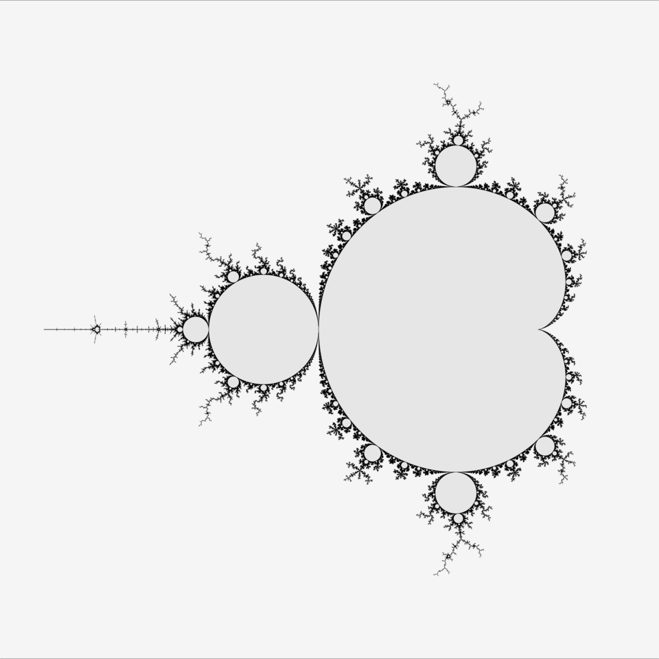

由于 Mandelbrot 集是完备集（full），<sup>[12]</sup> 任何被一个边界完全位于 Mandelbrot 集内部的闭合形状所包围的点，其本身也必在 Mandelbrot 集内。边界追踪的做法是：沿着绕集合一周的各个迭代层级（彩色条带）的双纽线行进，然后一次性填充整条带。这样也能提高速度，因为可以跳过大量点。<sup>[13]</sup>

[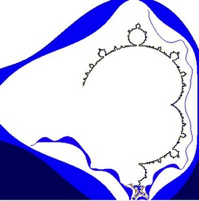](videos/Boundary_following_movie.webm)

在所示动画中，集合外部的点使用 1000 次迭代的逃逸时间算法着色。追踪集合边界并填充它，而不是迭代内部点，使总迭代次数减少了 93.16%。若迭代上限更高，收益还会更大。

### 矩形检查

矩形检查是一种更古老、更简单的 Mandelbrot 集绘制方法。其基本思想是：如果矩形边界上每个像素的迭代次数相同，那么这个矩形就可以安全地用该迭代次数填充。矩形检查法有多种变体，但它们都比边界追踪法慢，因为最终计算的像素更多。有一种变体只计算每个矩形的角像素，但这比计算整条边界更容易导致图像损坏，因此只有在使用约 6×6 像素的小方块、且不从更大的方块向内递归时才效果尚可（Fractint 方法）。

最简单的矩形检查方法是检查等大小矩形的边界，形似网格图案（Mariani 算法）。<sup>[14]</sup>

一种更快且稍高级的变体是：先计算一个较大的方块，比如 25×25 像素。如果整个方块边界颜色相同，就用该颜色填充方块；若不相同，则把方块分成四个 13×13 像素的方块，复用已计算过的像素作为外边界，并在内层方块之间共享内部的“十字”像素。同样地，填充只有一个边界颜色的方块，再把不满足条件的方块分成四个 7×7 像素的方块，最后把仍“失败”的分成 4×4 像素的方块（Mariani–Silver 算法）。

更快的方法是把方块对半分割，而不是分成四块。此时使用 1.4:1 长宽比的方块可能最优，这样就可以像 A3 纸折成 A4、A5 纸那样分割（DIN 方法）。

与边界追踪一样，矩形检查只适用于具有单一离散颜色的区域。但即便外部区域使用平滑/连续着色，矩形检查仍能加速 Mandelbrot 集内部那片代价高昂的区域——除非内部区域也使用某种平滑着色方法，例如内部距离估计。

### 对称性利用

Mandelbrot 集的水平对称性使得当最终图像中出现实轴时，可以跳过部分渲染过程。不过，无论镜像的是哪一部分，渲染的点数都相同。

Julia 集关于原点对称。这意味着第一象限与第三象限对称，第二象限与第四象限对称。要同时支持 Mandelbrot 集与 Julia 集的对称性，需要对这两类不同的图形以不同方式处理对称。

### 多线程

Mandelbrot 集与 Julia 集的逃逸时间渲染极适合并行处理。在多核机器上，可以把待绘制的区域划分成一系列矩形区域，再将它们作为一组任务交给渲染线程池处理。这是一个“易并行”（embarrassingly parallel）<sup>[15]</sup> 的计算问题。（注意：最佳加速方式是先排除图形中的对称区域，再把剩余的独立区域划分成矩形区域。）<sup>[16]</sup>

下面这段短视频展示了使用多线程与对称性、但未启用边界追踪的 Mandelbrot 集渲染过程：

[](videos/Multi-threaded_mandelbrot_render_w_symmetry.webm)

最后，这段视频展示了同一幅 Mandelbrot 集图像使用多线程、对称性**以及**边界追踪的渲染过程：

[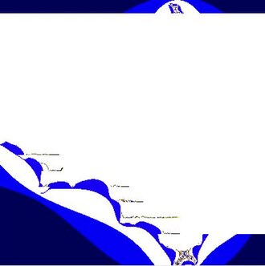](videos/Multi-threaded_mandelbrot_render_w_boundary_following_and_symmetry.webm)

### 摄动理论与级数近似

放大倍数极高的图像需要超过大多数硬件浮点单元所提供的标准 64–128 位左右的精度，从而迫使渲染器使用缓慢的 “BigNum”（大数）或“任意精度”数学库来计算。不过，利用摄动理论可以加速这一过程。给定迭代式

$$z_{n+1} = z_n^2 + c$$

以及很小的 epsilon 与 delta，则有

$$(z_n + \epsilon)^2 + (c + \delta) = z_n^2 + 2z_n\epsilon + \epsilon^2 + c + \delta,$$

或

$$= z_{n+1} + 2z_n\epsilon + \epsilon^2 + \delta,$$

因此若定义

$$\epsilon_{n+1} = 2z_n\epsilon_n + \epsilon_n^2 + \delta,$$

就可以先用高精度算术（*z*）计算单个点（例如图像中心），得到一条*参考轨道*，然后以各种初始偏移 delta 加上上述 epsilon 的迭代式，计算其周围的大量点，其中 epsilon 的初值设为 0。对大多数迭代而言，epsilon 不需要超过 16 位有效数字，因此可以用硬件浮点得到大部分准确的图像。<sup>[17]</sup> 常常会有一些区域，其中点的轨道与参考轨道偏离得足够远，以至于这些点需要额外精度，或者需要另外的、局部以高精度计算的参考轨道。通过度量参考点与以低精度计算的点之间的轨道距离，可以检测出该点无法被正确计算，从而停止计算。这些不正确的点之后可以从另一个更近的参考点重新计算。

此外，还可以用截断的 Taylor 级数来近似低精度点的起始值，这往往能跳过相当多的迭代。<sup>[18]</sup> 实现这些技术的渲染器是公开可得的，对高倍放大的图像能带来约两个数量级的加速。<sup>[19][20]</sup>

对上述内容的一种替代解释：

对于圆盘中的中心点 $c$ 及其迭代 $z_n$，以及圆盘中任意一点 $c + \delta$ 及其迭代 $z'_n$，可以定义如下迭代关系：

$$z'_{n} = z_{n} + \epsilon_{n}$$

其中 $\epsilon_{1} = \delta$。$\epsilon_n$ 的相继迭代可以用下式求出：

$$z'_{n+1} = {z'_n}^2 + (c + \delta)$$

$$z'_{n+1} = (z_n + \epsilon_n)^2 + c + \delta$$

$$z'_{n+1} = {z_n}^2 + c + 2z_n\epsilon_n + {\epsilon_n}^2 + \delta$$

$$z'_{n+1} = z_{n+1} + 2z_n\epsilon_n + {\epsilon_n}^2 + \delta$$

现在由原始定义：

$$z'_{n+1} = z_{n+1} + \epsilon_{n+1},$$

可得：

$$\epsilon_{n+1} = 2z_n\epsilon_n + {\epsilon_n}^2 + \delta$$

由于该迭代关系把一个任意点与中心点以极小的改变量 $\delta$ 联系起来，所以 $\epsilon_n$ 的绝大多数迭代值也很小，可以用浮点硬件计算。

然而，对于圆盘中的每个任意点，都可以不从头沿序列迭代（从 $\epsilon_0$ 起），而是把 $\epsilon_n$ 表示为 $\delta$ 的幂级数来算出给定 $\epsilon_{n}$ 的值。

$$\epsilon_n = A_{n}\delta + B_{n}\delta^2 + C_{n}\delta^3 + \dotsc$$

其中 $A_{1} = 1, B_{1} = 0, C_{1} = 0, \dotsc$。

现在，给定 $\epsilon$ 的迭代方程，就可以算出每个 $\epsilon_n$ 的幂级数系数：

$$\epsilon_{n+1} = 2z_n\epsilon_n + {\epsilon_n}^2 + \delta$$

$$\epsilon_{n+1} = 2z_n(A_n\delta + B_n\delta^2 + C_n\delta^3 + \dotsc) + (A_n\delta + B_n\delta^2 + C_n\delta^3 + \dotsc)^2 + \delta$$

$$\epsilon_{n+1} = (2z_nA_n+1)\delta + (2z_nB_n + {A_n}^2)\delta^2 + (2z_nC_n + 2A_nB_n)\delta^3 + \dotsc$$

因此可得：

$$A_{n+1} = 2z_nA_n + 1$$

$$B_{n+1} = 2z_nB_n + {A_n}^2$$

$$C_{n+1} = 2z_nC_n + 2A_nB_n$$

$$\vdots$$

幂级数中的系数可以只用中心点迭代值 $z$ 以迭代序列的方式算出，并且对圆盘中任何任意点都不变。若 $\delta$ 非常小，则只用幂级数的少数几项就应能把 $\epsilon_n$ 计算到足够精度。由于 Mandelbrot 逃逸轮廓在复平面上是“连续的”，若某点的逃逸时间已算出，则该点邻近点的逃逸时间应当相近。对邻近点进行插值，应当能为 $\epsilon_n$ 级数从何处开始提供良好的估计。

此外，分别对实轴方向与虚轴方向的点做插值，应当能为待计算的点同时给出上界与下界。若两个结果相同（即两者都逃逸或都不逃逸），则可以用差值 $\Delta n$ 递归，直到能同时确定上界与下界。若能用浮点硬件迭代 $\epsilon$ 级数，则存在一种关系：用 BigNum 软件计算某个 $\epsilon_n$ 的时间，相当于用浮点硬件完成多少次迭代。若上下界之差大于该迭代次数，就可以用 BigNum 软件做二分搜索，不断把差距减半，直到用浮点硬件找出逃逸值在时间上更划算为止。

| 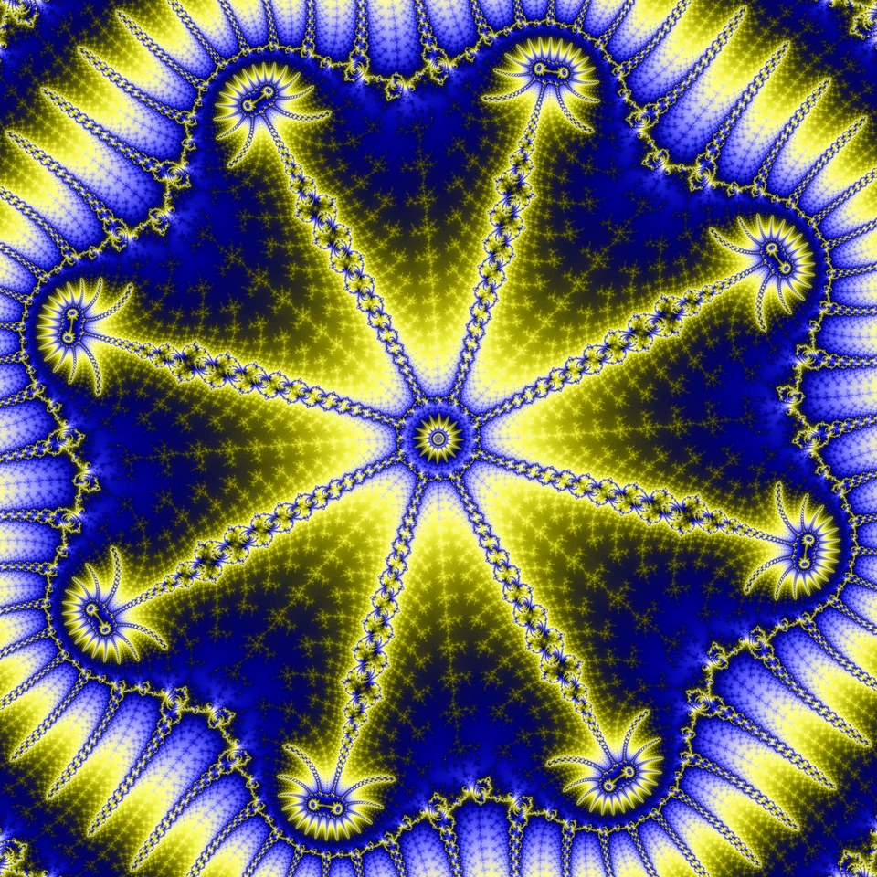 | 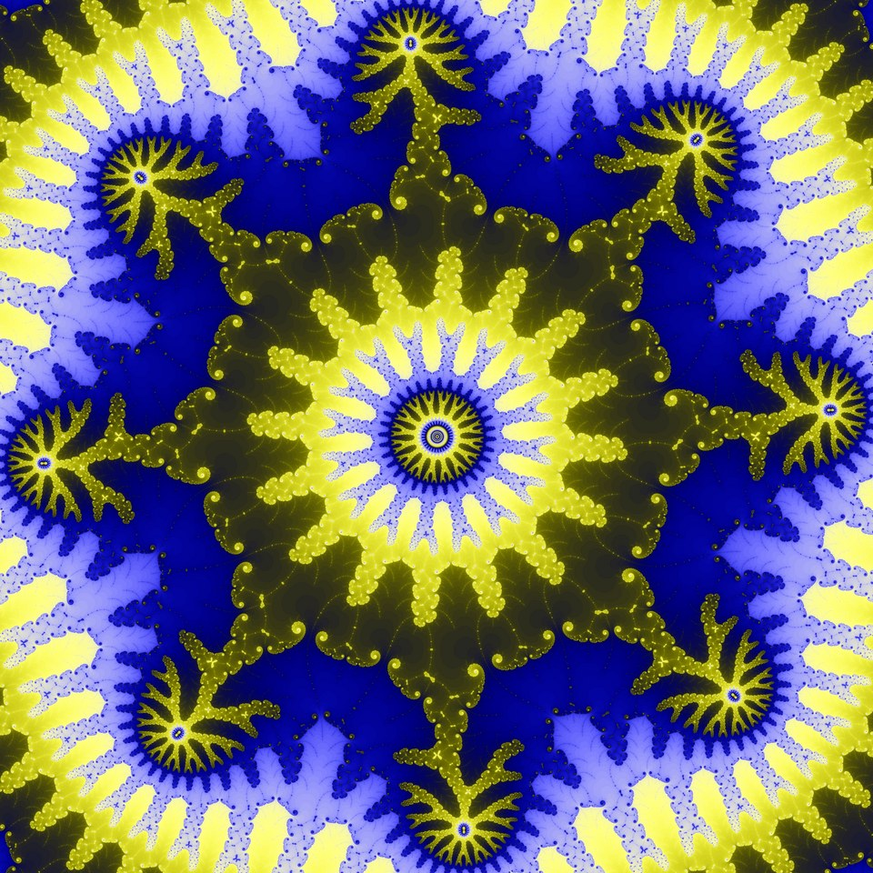 | 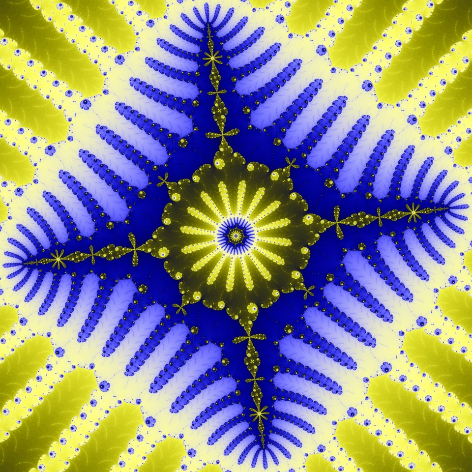 |
|:--:|:--:|:--:|
| 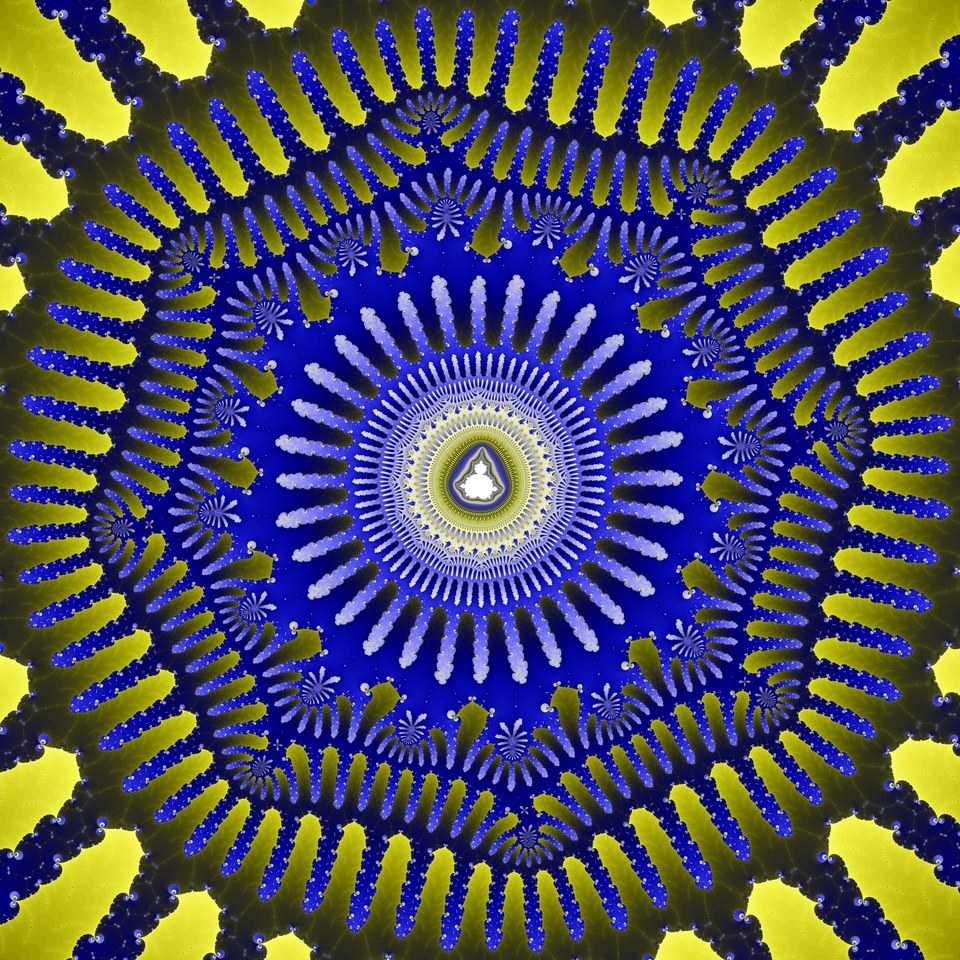 | 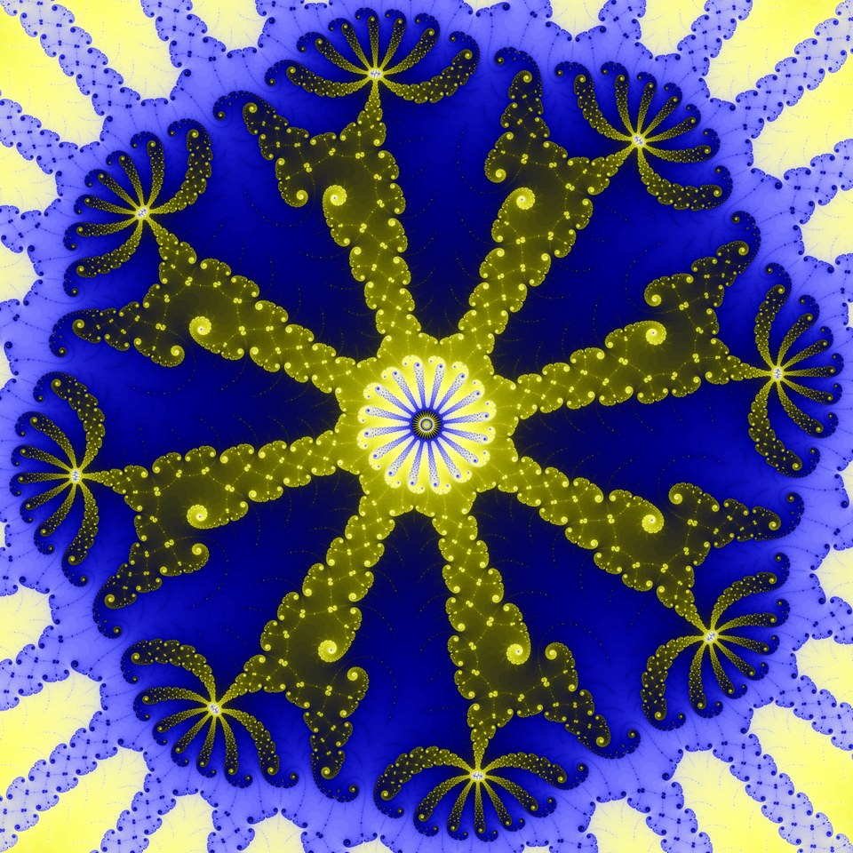 | 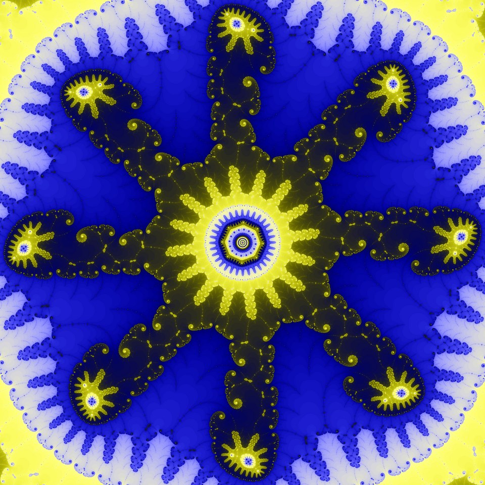 |

: 使用摄动理论得到的各个缩放级别。（六幅图像均为 Aokoroko 所作，CC0）

## 参考文献

1. "Newbie: How to map colors in the Mandelbrot set?"（http://www.fractalforums.com/programming/newbie-how-to-map-colors-in-the-mandelbrot-set/msg3465/#msg3465）。www.fractalforums.com。2007 年 5 月。原始内容存档于 2022 年 9 月 9 日（https://web.archive.org/web/20220909215450/http://www.fractalforums.com/programming/newbie-how-to-map-colors-in-the-mandelbrot-set/msg3465/#msg3465）。2020 年 2 月 11 日检索。
2. García, Francisco; Ángel Fernández; Javier Barrallo; Luis Martín. "Coloring Dynamical Systems in the Complex Plane"（http://math.unipa.it/~grim/Jbarrallo.PDF）（PDF）。原始内容存档于 2019 年 11 月 30 日（https://web.archive.org/web/20191130214645/http://math.unipa.it/%7Egrim/Jbarrallo.PDF）（PDF）。2008 年 1 月 21 日检索。
3. Linas Vepstas. "Renormalizing the Mandelbrot Escape"（http://linas.org/art-gallery/escape/escape.html）。原始内容存档于 2020 年 2 月 14 日（https://web.archive.org/web/20200214073730/http://linas.org/art-gallery/escape/escape.html）。2020 年 2 月 11 日检索。
4. Albert Lobo. "Interior and exterior distance bounds for the Mandelbrot set"（http://www.albertlobo.com/fractals/interior-exterior-distance-bounds-mandelbrot-set）。原始内容存档于 2022 年 9 月 9 日（https://web.archive.org/web/20220909215805/http://www.albertlobo.com/fractals/interior-exterior-distance-bounds-mandelbrot-set）。2021 年 4 月 29 日检索。
5. Wilson, Dr. Lindsay Robert (2012). "Distance estimation method for drawing Mandelbrot and Julia sets"（http://www.imajeenyus.com/mathematics/20121112_distance_estimates/distance_estimation_method_for_fractals.pdf）（PDF）。原始内容存档于 2021 年 5 月 3 日（https://web.archive.org/web/20210503103652/http://www.imajeenyus.com/mathematics/20121112_distance_estimates/distance_estimation_method_for_fractals.pdf）（PDF）。2021 年 5 月 3 日检索。
6. Chéritat, Arnaud (2016). "Boundary detection methods via distance estimators"（https://www.math.univ-toulouse.fr/~cheritat/wiki-draw/index.php/Mandelbrot_set#Boundary_detection_methods_via_distance_estimators）。原始内容存档于 2022 年 12 月 18 日（https://web.archive.org/web/20221218100822/https://www.math.univ-toulouse.fr/~cheritat/wiki-draw/index.php/Mandelbrot_set）。2023 年 1 月 2 日检索。
7. Christensen, Mikael Hvidtfeldt (2011). "Distance Estimated 3D Fractals (V): The Mandelbulb & Different DE Approximations"（http://blog.hvidtfeldts.net/index.php/2011/09/distance-estimated-3d-fractals-v-the-mandelbulb-different-de-approximations）。原始内容存档于 2021 年 5 月 13 日（https://web.archive.org/web/20210513033347/http://blog.hvidtfeldts.net/index.php/2011/09/distance-estimated-3d-fractals-v-the-mandelbulb-different-de-approximations/）。2021 年 5 月 10 日检索。
8. Dang, Yumei; Louis Kauffman; Daniel Sandin (2002). "Chapter 3.3: The Distance Estimation Formula". Hypercomplex Iterations: Distance Estimation and Higher Dimensional Fractals（https://www.evl.uic.edu/hypercomplex/html/book/book.pdf）（PDF）。World Scientific。第 17–18 页。原始内容存档于 2021 年 3 月 23 日（https://web.archive.org/web/20210323153331/https://www.evl.uic.edu/hypercomplex/html/book/book.pdf）（PDF）。2021 年 4 月 29 日检索。
9. Peitgen, Heinz-Otto; Richter Peter (1986). The Beauty of Fractals. Heidelberg: Springer-Verlag. ISBN 0-387-15851-0.
10. Peitgen, Heinz-Otto; Saupe Dietmar (1988). The Science of Fractal Images. New York: Springer-Verlag. 第 202 页. ISBN 0-387-96608-0.
11. "Mandelbrot Bud Maths"（http://linas.org/art-gallery/bud/bud.html）。原始内容存档于 2020 年 2 月 14 日（https://web.archive.org/web/20200214073800/http://linas.org/art-gallery/bud/bud.html）。2020 年 2 月 11 日检索。
12. Douady, Adrien; Hubbard, John (2009). "Exploring the Mandelbrot set. Exploring the Mandelbrot set. The Orsay Notes"（https://www.researchgate.net/publication/228540477）。2023 年 4 月 9 日检索。
13. "Boundary Tracing Method"（https://web.archive.org/web/20150220012221/http://www.reocities.com/CapeCanaveral/5003/mandel.htm）。原始内容（http://www.reocities.com/CapeCanaveral/5003/mandel.htm）存档于 2015 年 2 月 20 日。
14. Dewdney, A. K. (1989). "Computer Recreations, February 1989; A tour of the Mandelbrot set aboard the Mandelbus". Scientific American. 第 111 页. JSTOR 24987149（https://www.jstor.org/stable/24987149）。（需要订阅）
15. "Embarrassingly Parallel Problems"（https://web.archive.org/web/20200127230256/http://courses.cecs.anu.edu.au/courses/COMP4300/lectures/embParallel.4u.pdf）（PDF）。原始内容（http://courses.cecs.anu.edu.au/courses/COMP4300/lectures/embParallel.4u.pdf）（PDF）存档于 2020 年 1 月 27 日。
16. "Parallel Program Models"（https://web.archive.org/web/20200126040920/http://cseweb.ucsd.edu/groups/csag/html/teaching/cse160s05/lectures/Lecture14.pdf）（PDF）。原始内容（http://cseweb.ucsd.edu/groups/csag/html/teaching/cse160s05/lectures/Lecture14.pdf）（PDF）存档于 2020 年 1 月 26 日。
17. "Superfractalthing - Arbitrary Precision Mandelbrot Set Rendering in Java"（http://www.fractalforums.com/announcements-and-news/superfractalthing-arbitrary-precision-mandelbrot-set-rendering-in-java/）。原始内容存档于 2020 年 6 月 30 日（https://web.archive.org/web/20200630043303/http://www.fractalforums.com/announcements-and-news/superfractalthing-arbitrary-precision-mandelbrot-set-rendering-in-java/）。2020 年 2 月 11 日检索。
18. K. I. Martin. "Superfractalthing Maths"（https://web.archive.org/web/20140628114658/http://www.superfractalthing.co.nf/sft_maths.pdf）（PDF）。原始内容（http://www.superfractalthing.co.nf/sft_maths.pdf）（PDF）存档于 2014 年 6 月 28 日。2020 年 2 月 11 日检索。
19. "Mandelbrot set implementation with Perturbation Theory"（https://rosettacode.org/wiki/Mandelbrot_set#Perturbation_Theory）。Rosetta Code。2026 年 7 月 6 日检索。
20. "Kalles Fraktaler 2"（http://www.chillheimer.de/kallesfraktaler/）。原始内容存档于 2020 年 2 月 24 日（https://web.archive.org/web/20200224054206/http://www.chillheimer.de/kallesfraktaler/）。2020 年 2 月 11 日检索。

原文取自 "https://en.wikipedia.org/w/index.php?title=Plotting_algorithms_for_the_Mandelbrot_set&oldid=1380046103"

原文正文依据 知识共享 署名-相同方式共享 4.0 许可协议（CC BY-SA 4.0）提供，并可能附加其他条款。媒体文件许可详见 [LICENSES.md](LICENSES.md)。
